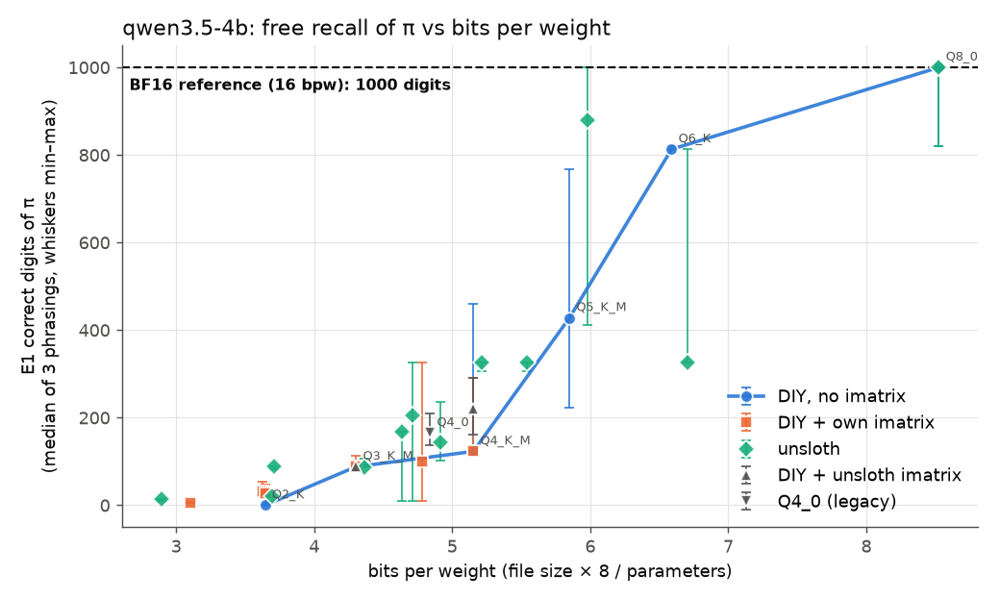
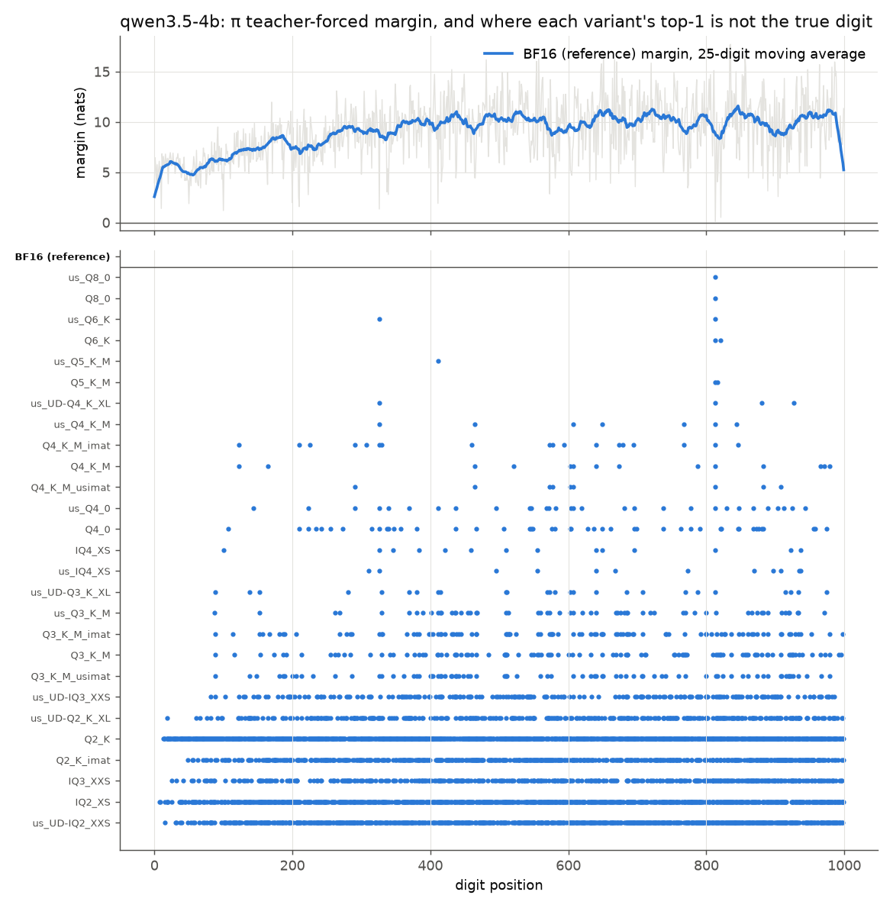
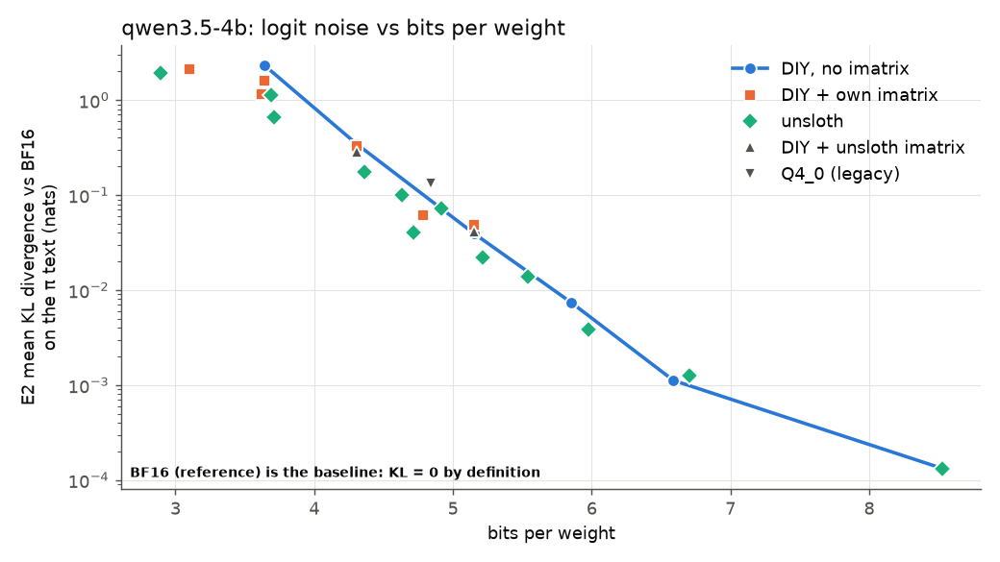
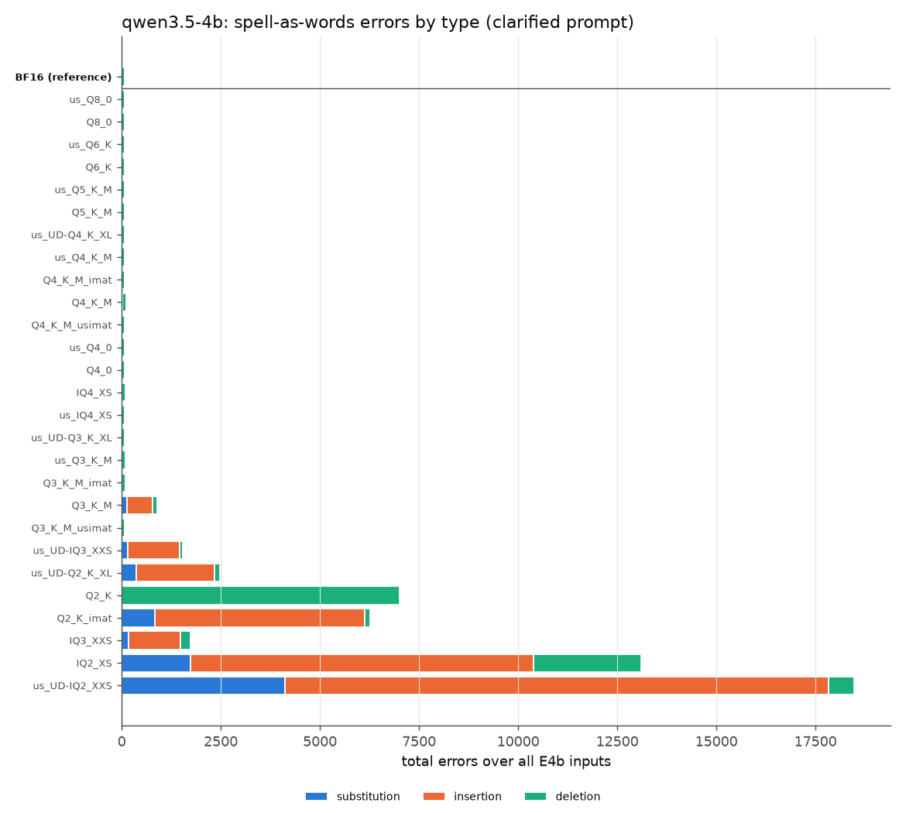
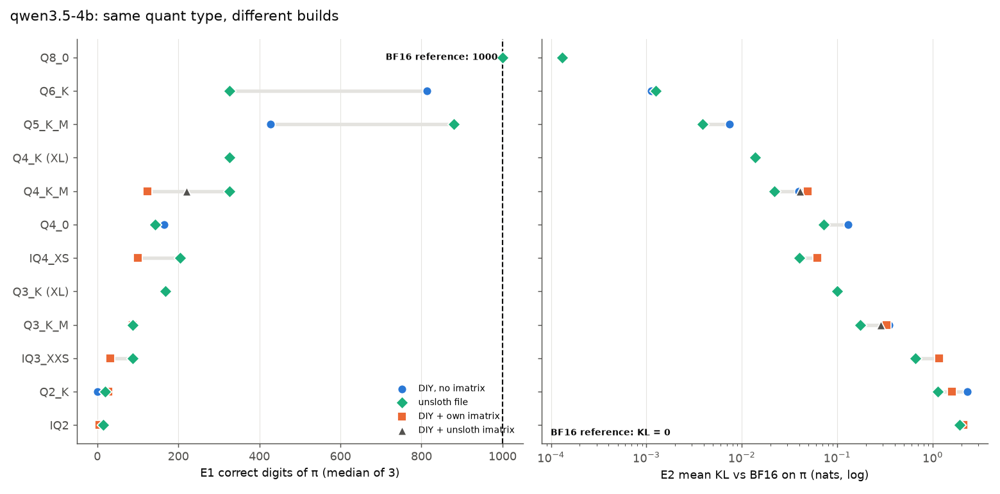
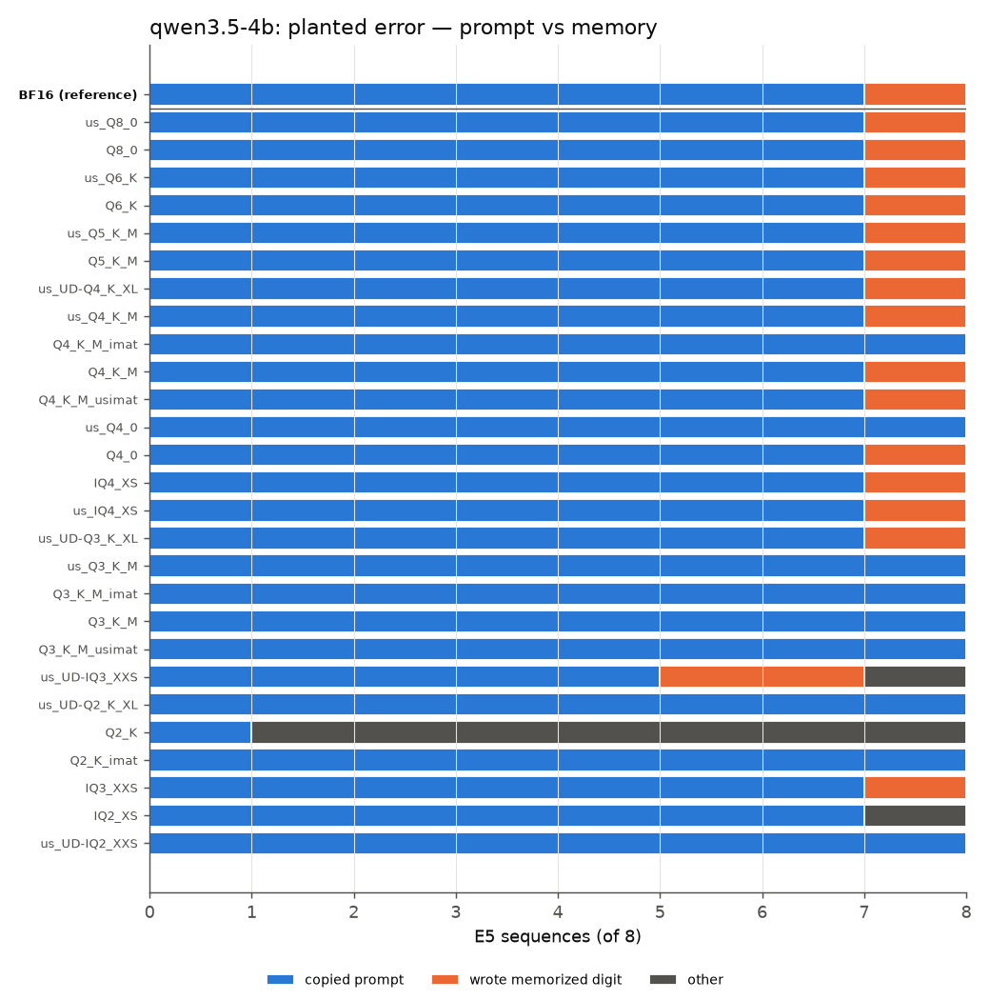
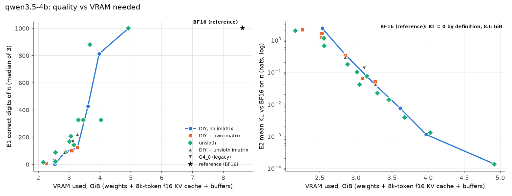
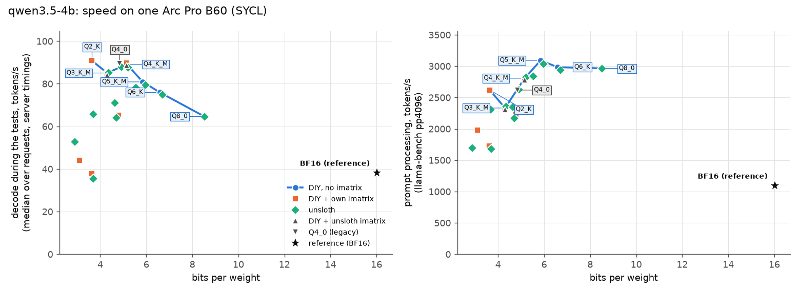

# Phase 1 report: Qwen 3.5 4B

Kiryl Dubarenka

Web version: [bits-of-pi.engineeringthefuture.ai](https://bits-of-pi.engineeringthefuture.ai/)

Shrinking a language model's file makes it cheaper to run. What does it cost? Some answers
from a model hinge on a single token chosen by a hair: the 327th digit of π, say, or one digit
in a long account number. This study measures how compression damages exactly that kind of answer.

I took one model, Qwen 3.5 4B, and ran 28 versions of it. They go from the full-size original
(16 bits per weight) down to heavily compressed files at 2.9 bits per weight. Every version ran
through the same llama.cpp build (`bed0a8566`, SYCL backend, one Intel Arc Pro B60 graphics
card), and every answer was greedy, meaning the model always picks its most likely next token.
Every number below comes from the scored data in `scores/`, the per-digit records in `tf/` and
the per-version summaries in `runs/`, produced by `scripts/analyze.py`. The full table for all
28 versions is [`scores/qwen3.5-4b_headline.md`](scores/qwen3.5-4b_headline.md).

## Words used in this report

**Quantization** means storing each of the model's numbers (its weights) with fewer bits. The
file shrinks and runs faster, and every calculation picks up a little rounding error.

**Bits per weight (bpw)** is the average number of bits each weight takes in the file. I
measure it directly: file size × 8 ÷ number of weights. The original is 16. On this small model
the measured value runs 0.3–0.4 above the name on the tin, because the large vocabulary layers
are kept at higher precision. Q4_K_M, for example, measures 5.15 bpw here, not 4.8.

**Version names** come from llama.cpp:

- **BF16** is the uncompressed original, 16 bits per weight. It is the **reference**, the
  version everything else is compared against.
- **Q8_0, Q6_K, Q5_K_M, Q4_K_M, Q3_K_M, Q2_K** are standard compressed formats. The number is
  roughly the bits per weight. **K** marks llama.cpp's newer "K-quant" family. A trailing
  **_S, _M, _L** or **_XL** is a size within that format (small, medium, large, extra large).
- **Q4_0** is an older ("legacy") 4-bit format.
- **IQ4_XS, IQ3_XXS, IQ2_XS, IQ2_XXS** are "I-quants", a family that packs weights through
  lookup tables to squeeze out more space.
- A **us_** prefix means the file was downloaded from unsloth, a group that publishes compressed
  models. No prefix means I built it myself with llama.cpp's own tool.
- **UD-** means "Unsloth Dynamic": unsloth picks a different precision layer by layer,
  spending more bits on the parts that matter most.
- An **imatrix** (importance matrix) records which weights matter most on a sample text, so
  that compression can protect them. **_imat** means I built the file with my own imatrix,
  made from Wikipedia text with every number removed. **_usimat** means my build with
  unsloth's imatrix.
- The **plain ladder** (also "DIY, no imatrix" in the figures) is my own set of builds with no
  imatrix: Q8_0, Q6_K, Q5_K_M, Q4_K_M, Q3_K_M, Q2_K. It changes only the bit width, so it is
  the cleanest comparison.

**The tests:**

- **E0** checks the setup: each digit is its own token, the model's "thinking" mode is off,
  and repeated runs give identical output.
- **E1** asks the model to recite π, e and √2 from memory, in three different wordings. The
  score is how many digits come out right before the first mistake. The figures show the
  middle score of the three wordings (the **median of 3**).
- **E2** is **teacher forcing**. The model doesn't write anything. I feed it the true digits
  one at a time and record, at every position, how strongly it expected the right next digit.
- **E3** asks the model to copy a random string of digits from the prompt.
- **E4b** asks it to write a digit string out as words ("507" becomes "five zero seven").
  E4 was the first version of this prompt. It failed as a test, as explained under H3.
- **E5** gives the model a copy of π or e with one digit deliberately changed and asks for an
  exact copy. Does it copy the changed digit, or "fix" it from memory?
- **E6** asks it to recite π, e and √2 from memory as words.

**Measures from teacher forcing (E2):**

- **Top-1** is the digit the model would pick at a position. A **flip** is a position where a
  compressed version's top-1 differs from the reference's.
- **Margin** says how sure the model is of a digit. I give it as **odds**: how many times more
  likely the right digit is than the runner-up. 1× is a dead heat, 4× is shaky, and 10,000×
  is certain. (Technical readers: the raw margin is a gap in log-probability, in "nats". Odds
  are e raised to that number.)
- **Percentile of margin** places one digit among all 1,000. The 2nd percentile means only
  2% of digits are less certain.
- **Noise** is my plain name for the **KL divergence**: how far a compressed version's
  predictions drift from the reference's, averaged over every position. It has no everyday
  unit, so read it against what it did in this study:

  | Noise | What it looked like here |
  |---|---|
  | 0.0001 | recites exactly like the reference. Only a near-tie digit can flip |
  | about 0.001 | one or two of the least certain digits of π flip |
  | about 0.01 | π recall stops somewhere in the first few hundred digits |
  | about 0.1 | π recall drops to around 100 digits |
  | 1 and above | π recall is close to zero, and some builds can't copy either |

  "Noise on π" is measured on the π digits (memorized content). "Noise on random" is measured
  on random digits, which nobody can have memorized, so it shows generic damage.

**Other measures:** decode speed is how fast the model writes, in tokens per second (tok/s).
Prompt speed is how fast it reads a long prompt (4,096 tokens, called pp4096). VRAM is the
graphics memory used, in GiB (1 GiB = 1.07 GB). In the copy tests an error is a
**substitution** (wrong digit), an **insertion** (extra digit) or a **deletion** (missing
digit), and a **run** is a stretch of repeated digits like 8888.

**Log scale.** Several figures plot noise on a log scale, where each gridline is 10 times
the one below. Read the height as an order of magnitude. A point one gridline lower has a tenth
of the noise.

**Marker shapes in the figures** (the same in every figure for every model):

| Marker | Meaning |
|---|---|
| blue circle, joined by a line | plain ladder (my builds, no imatrix) |
| orange square | my build with my own imatrix |
| green diamond | unsloth's published file |
| dark triangle, point up | my build with unsloth's imatrix |
| dark triangle, point down | legacy Q4_0 |
| black star, or dashed black line | the reference |

Only the plain ladder is joined by a line. The other groups mix different formats, and a line
through them would suggest a trend that isn't there.

## Summary

| Hypothesis | Verdict | What decided it |
|---|---|---|
| H1: recall survives down to about 4 bits, then falls off a cliff | **Rejected as stated** | π recall starts dropping at 6.6 bpw and keeps dropping, with no flat stretch down to 4 bits ([H1](figures/qwen3.5-4b_H1_recall.png)) |
| H2: errors start where the model was least sure | **Confirmed** | Recall stops on the digits the reference was least sure of, and noise on π grows 7.6× per bit removed ([H2](figures/qwen3.5-4b_H2_margins.png), [KL](figures/qwen3.5-4b_H2_kl.png)) |
| H3: copying from the prompt holds up, and when it fails it skips digits in runs | **Confirmed** | Every build at 4.3 bpw or more copies almost perfectly. Errors are missing digits inside runs, even at BF16 ([E3](figures/qwen3.5-4b_H3_E3.png), [E4b](figures/qwen3.5-4b_H3_E4b.png)) |
| H4: the compression scheme matters at equal size | **Confirmed, with a twist** | K-quants beat Q4_0 by 3.3× on π noise. A number-free imatrix cuts generic noise but not π noise. unsloth's recipe beats all my builds ([H4](figures/qwen3.5-4b_H4_builds.png)) |
| H5: bigger models have more room to compress | See [Phase 2](REPORT_9B.md) and [Phase 3](REPORT_27B.md) | |
| H6: compressed models fall back on memory over the prompt | **Rejected, reversed** | The more compressed versions copy the planted digit *more* faithfully ([H6](figures/qwen3.5-4b_H6_planted.png)) |

What this means if you run this model on this card:

- **Q8_0 costs nothing.** It gives the same answers as BF16 on every test (noise 0.0001),
  decodes 1.7× faster and uses 43% less graphics memory.
- **If you need exact recall, stay at Q6_K or above.** Each bit removed multiplies the noise
  on memorized digits by about 7.6. π recall halves somewhere between Q6_K and Q5_K_M.
- **If the answer is in the prompt and the model only has to copy it, nearly any build works**
  down to Q3_K_M, and down to Q2_K if it was built with an imatrix. Plain Q2_K and my IQ3_XXS
  and IQ2_XS builds break.
- **Pick unsloth's file over a standard build of the same format.** At Q4_K_M and Q3_K_M it has
  about half the noise on π, at the same size and speed.
- **Avoid IQ formats on this backend.** IQ3_XXS decodes at 35–38 tokens/s, slower than the
  uncompressed BF16.

## H1: recall declines early and steadily

Asked for π, the BF16 original recites **1,000 correct digits** and stops there, because the
prompt asked for 1,000. It gets 192 digits of e and 105 of √2. Only π gives enough room to
watch recall shrink, so π carries this hypothesis.

*How to read it:* each marker is one version. Across is its bits per weight, so the most
compressed files sit on the left. Up is how many digits of π it recited before the first
mistake, taking the middle of its three wordings. The whisker runs from the worst wording to
the best. The dashed line is BF16. Shapes follow the table above.

| Plain ladder | bpw | π digits (median of 3) | Noise on π | Noise on random digits |
|---|---|---|---|---|
| BF16 (reference) | 16.0 | 1000 | 0 | 0 |
| Q8_0 | 8.5 | 1000 | 0.00013 | 0.00008 |
| Q6_K | 6.6 | 813 | 0.0011 | 0.0012 |
| Q5_K_M | 5.9 | 428 | 0.0075 | 0.0012 |
| Q4_K_M | 5.2 | 123 | 0.039 | 0.0033 |
| Q3_K_M | 4.3 | 88 | 0.35 | 0.0059 |
| Q2_K | 3.6 | 0 | 2.30 | 0.045 |

There is no safe zone down to 4 bits. Recall falls below half of BF16's already at Q5_K_M, 5.9
bits per weight. The noise rises smoothly as bits drop. The jumps in recall come from a few
specific digits, not from any threshold in bits (see H2).

Memorized digits break much more easily than ordinary digit prediction. At Q4_K_M the noise on π
is **12 times** the noise on random digits. With each bit removed, the noise on π grows 7.6×,
and the noise on random digits 3.2×.

Neighbouring versions can score very differently. My Q6_K recites 813 digits and unsloth's Q6_K
326, with almost the same noise (0.0011 against 0.0013). Both are balanced on digit 326, and one
gets past it while the other doesn't. Noise is the steadier measure, and recall shows what the
noise does to an answer.

## H2: errors start where the model was least sure

In teacher forcing the model reads the true 1,000 digits of π, and at each position I record
how far the right digit led the runner-up (the margin).

- BF16 gets all 1,000 positions right. For a typical digit (the median), the right answer is
  about 10,000 times more likely than the runner-up. A few digits are nearly tied, though.
  At position 813 the right digit is only 1.1 times as likely as the runner-up, at 326 3.8
  times, at 10 4.1 times.
- Free recall fails on exactly those digits. Of 77 π recitations that stopped early, the most
  common stopping points are 326 (8 times), 88 (7), and 821, 10, 87 and 123 (4 each). The
  typical stop sits at the 12th percentile of BF16's margins.
- With few bits removed, only the least certain digits flip. Q6_K's two teacher-forced errors
  are at positions 813 and 821, both in the least certain 0.1%. At Q4_K_M the 14 errors sit around
  the 7.6th percentile. From Q3_K_M (104 errors) down, the noise is bigger than most margins,
  and errors appear everywhere.

*How to read it:* the top panel shows how sure BF16 is of each of the 1,000 digits of π, as
odds against the runner-up on a log scale (1× is a tie, and each labelled line is 100 times the
one below). The grey trace is each digit, and the blue line smooths it over 25 digits. The deep
grey dips are the digits the model barely knows. Certainty also grows the further into π it
gets, from about 100× near the start to about 10,000×. The bottom panel has one row per version, from least to most
compressed. A dot marks each position where that version's top-1 digit is wrong under teacher
forcing. The rows near the top have dots only under the thin-margin positions (326, 813). Lower
rows fill in.

*How to read it:* up is the noise on the π text, on a log scale where each gridline is 10
times the one below. Across is bits per weight. BF16 itself is not shown, since
its noise is zero by definition. The plain ladder falls in a nearly straight line, which on a
log scale means the noise multiplies by a fixed factor with every bit removed.

## H3: copying holds, and it fails by skipping digits in runs

**Copying digits (E3).** 40 random strings of 100 to 1,000 digits, 17,000 digits in all. BF16
makes 3 errors, all single extra digits. Every build at 4.3 bits per weight or more copies the
1,000-digit strings perfectly. Only three builds break:

| Version | bpw | Errors per 100 digits | On 1,000-digit strings | What goes wrong |
|---|---|---|---|---|
| Q2_K (no imatrix) | 3.6 | 59 | 99 | mostly missing digits: the model gives up |
| IQ3_XXS (my imatrix) | 3.6 | 9.0 | 36 | whole chunks dropped |
| IQ2_XS (my imatrix) | 3.1 | 12 | 39 | mixed |

The same formats work when built differently. Q2_K with an imatrix makes 0.06 errors per 100,
and unsloth's UD-IQ3_XXS 0.03.

**Writing digits as words (E4b).** Here even BF16 drops digits, and always inside runs. Strings
with many runs get 2.2 errors per 100 digits, against 0.3 on ordinary random strings. 75 of
BF16's 80 errors are a missing word inside a run of three or more equal digits: "eight eight
eight eight eight" written one "eight" short. That pattern stays the same down to about 4.3
bits per weight. Below that the failures change kind and become **extra** words, as the model
gets stuck repeating one (Q2_K_imat: 208 errors per 100 digits on run-heavy strings, 5,297 extra
words). Wrong digits stay rare everywhere except in builds that collapse completely.

*How to read it:* one bar per version, with the reference at the top. The length of the bar is
the total number of errors over all E4b strings. Blue is wrong digits, orange extra digits,
green missing digits. Most bars are too short to see. Plain Q2_K is mostly green (it stops
writing), and the IQ2 and 2-bit builds are mostly orange (they repeat words). The E3 figure,
[`qwen3.5-4b_H3_E3.png`](figures/qwen3.5-4b_H3_E3.png), uses the same layout.

The first word prompt (E4) failed as a test. Qwen 3.5 4B read "write each digit as a word" as
"say this number" and answered "twenty trillion two hundred…", even at BF16. I kept its records.
E4b adds one example ("507 becomes: five zero seven") and replaces it.

## H4: format, imatrix and recipe

Each format was built several ways. Noise on π shows damage to memorized content, and noise on
random digits shows generic damage.

*How to read it:* one row per format, from the most bits at the top to the fewest at the bottom.
Each marker is one build of that format (shapes as in the table above), and the grey bar
spans the best and worst build. Left panel: digits of π, where further right is better and the
dashed line is BF16's 1,000. Right panel: noise on π on a log scale, where further left is
better. Rows marked (XL) are unsloth's larger UD-XL files.

| Build of Q4_K_M | π digits | Noise on π | Noise on random |
|---|---|---|---|
| plain | 123 | 0.039 | 0.0033 |
| with my number-free imatrix | 123 | 0.049 | 0.0016 |
| with unsloth's imatrix | 220 | 0.041 | 0.0024 |
| unsloth's file | 326 | 0.022 | 0.0019 |
| unsloth UD-Q4_K_XL (6% larger) | 326 | 0.014 | 0.0013 |

| Build of Q3_K_M | π digits | Noise on π | Noise on random |
|---|---|---|---|
| plain | 88 | 0.35 | 0.0059 |
| with my imatrix | 88 | 0.33 | 0.0045 |
| with unsloth's imatrix | 88 | 0.29 | 0.0028 |
| unsloth's file | 87 | 0.17 | 0.0027 |
| unsloth UD-Q3_K_XL (8% larger) | 168 | 0.10 | 0.0025 |

- **Format.** At the same size, the legacy Q4_0 has 3.3 times the π noise of Q4_K_M (0.131
  against 0.039). Confirmed.
- **Imatrix.** My imatrix comes from text with no digit strings in it. It halves the generic
  noise at Q4_K_M and does nothing for π: the noise on π even goes up, from 0.039 to 0.049. An
  imatrix protects what its sample text uses, and the plan kept digits out of it on purpose to
  test exactly that. At 2–3 bits the imatrix matters for everything. It is the difference
  between a Q2_K that cannot copy (59 errors per 100 digits) and one that can (0.06).
- **Recipe beats calibration.** My Q4_K_M built with unsloth's own imatrix gains only a little
  (π noise 0.041, against 0.022 for their file). Most of unsloth's advantage comes from how they
  choose precision for each part of the model, not from their sample text. Their UD-XL files go
  further, at a cost in size and speed (see below).

## H6: compression weakens memory instead of strengthening it

E5 asks for an exact copy of π or e in which one digit has been changed. Of the 8 changed
positions, only position 10 of π separates the versions. BF16, and nearly every build at 4.6
bits per weight or more, "corrects" it back to the real digit of π. Nearly every build at 4.4
bits per weight or less copies the prompt faithfully. Compression weakens the pull of memory,
which fits H1. The hypothesis expected the opposite.

*How to read it:* one bar per version, 8 planted digits each. Blue counts the times it copied
the prompt faithfully, orange the times it wrote the true digit from memory instead, and dark
grey the times it did neither (the copy itself failed). The orange slice on BF16 and the higher
builds is π position 10.

Exceptions: my Q4_K_M_imat and unsloth's Q4_0 copy faithfully at about 5 bits per weight. My
IQ3_XXS reverts to memory at position 10, and unsloth's UD-IQ3_XXS at positions 10 and 50.
Plain Q2_K can't copy at all.

## Resources and speed

All runs used one Arc Pro B60 (24 GB), llama.cpp with SYCL, a context of 8,192 tokens and
flash attention off. Decode speed is the middle value the server reported during the real test
requests. It agrees with llama.cpp's own benchmark within 0–5%. Prompt speed comes from the
benchmark at 4,096 tokens, because short prompts carry a fixed overhead on this backend that
hides the real throughput.

| Version | File GB | VRAM GiB | Decode tok/s | Prompt tok/s (4k) | Power W |
|---|---|---|---|---|---|
| BF16 | 8.42 | 8.6 | 38 | 1,087 | 120 |
| Q8_0 | 4.48 | 4.9 | 65 | 2,964 | 127 |
| Q6_K | 3.46 | 4.0 | 76 | 2,984 | 147 |
| Q5_K_M | 3.07 | 3.6 | 81 | 3,092 | 142 |
| Q4_K_M | 2.71 | 3.3 | 89 | 2,807 | 138 |
| us_UD-Q4_K_XL | 2.91 | 3.5 | 78 | 2,838 | 132 |
| IQ4_XS | 2.51 | 3.1 | 65 | 2,223 | 130 |
| Q3_K_M | 2.26 | 2.9 | 85 | 2,332 | 139 |
| us_UD-IQ3_XXS | 1.95 | 2.6 | 35 | 1,674 | 113 |
| Q2_K | 1.92 | 2.5 | 91 | 2,617 | 136 |
| us_UD-IQ2_XXS | 1.52 | 2.2 | 53 | 1,693 | 129 |

- **Graphics memory is the file size plus about 770 MiB** for every version. The extra holds
  the conversation memory (the KV cache for 8,192 tokens) and working buffers, and it doesn't
  depend on the weights. Any 4 GB card holds every build up to Q5_K_M. BF16 needs about 9 GB.
- **Below about 5 bits, smaller files stop getting faster.** Decode goes 38 → 65 → 89 tokens/s
  from BF16 to Q8_0 to Q4_K_M, then stays flat down to Q2_K. Below 4–5 bits this card is no
  longer waiting on reading weights, so a smaller file saves memory and nothing else.
- **IQ formats are slow on this backend.** Unpacking their lookup tables costs more time than
  the smaller file saves. IQ3_XXS (35–38 tokens/s) decodes slower than BF16. UD-XL files decode
  12–28% slower than plain K-quants of a similar size.
- **Host memory** follows the file size, because the file is mapped into memory rather than
  copied. It is not needed on top of the graphics memory.

*How to read it:* the same quality measures as above, but across is now the graphics memory
each version needs (weights, plus the 8k-token cache, plus buffers). Left: digits of π, where
higher is better. Right: noise on π on a log scale, where lower is better. The black star is
BF16. This is the view for choosing a file to fit a given card.

*How to read it:* left is decode speed during the tests, and right is prompt speed at 4,096
tokens, both against bits per weight. Higher is faster. Plain-ladder points carry their names.
The black star is BF16. The green diamonds and orange squares well below the line on the left
are the IQ and UD files.

## Problems found and how they were handled

| Problem | Effect | What I did |
|---|---|---|
| The E4 prompt was read as "say this number" | E4 tested following instructions, not copying | Kept the records. Added E4b with an explicit example (approved) and reran it on all 28 versions |
| E6 (recall as words) gives nothing usable | BF16 counts "zero one two three…" instead of reciting | Reported as something the 4B can't do |
| "e to 1000 decimal places: 2." | BF16 answers with 1,200 zeros | Real model behaviour. Results reported per constant, π carries H1 |
| E5 copies leave out the decimal point | Early runs scored a false error | Fixed the extraction, with a test, before any real run |
| The server cached prompts in host memory | Inflated host memory, and possible reuse between requests | Turned off (`--cache-ram 0`) and reran the whole study |

The setup check (E0) passed on BF16 and Q8_0. The output was byte-for-byte identical on
repeated requests, after a server restart, and on both graphics cards.

## Next

Phase 2 (Qwen 3.5 9B) is in [REPORT_9B.md](REPORT_9B.md), and Phase 3 (Qwen 3.8 27B) in
[REPORT_27B.md](REPORT_27B.md). Questions still open from Phase 1:

- Keep E6 for larger models, or drop it?
- The imatrix question is sharper now. A number-free sample text leaves recall unprotected.
  Would "ordinary text plus some numbers" be the fairer choice for H4?
