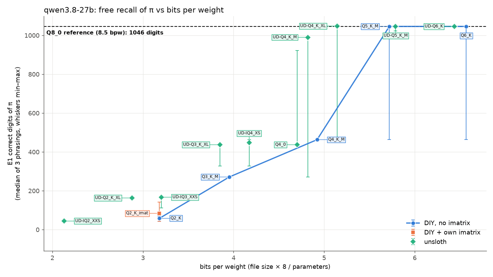
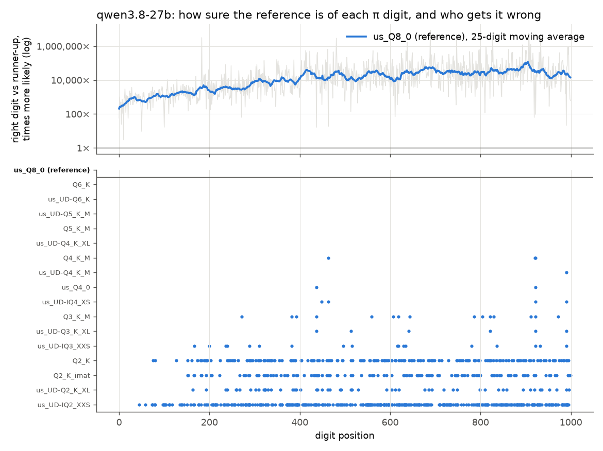
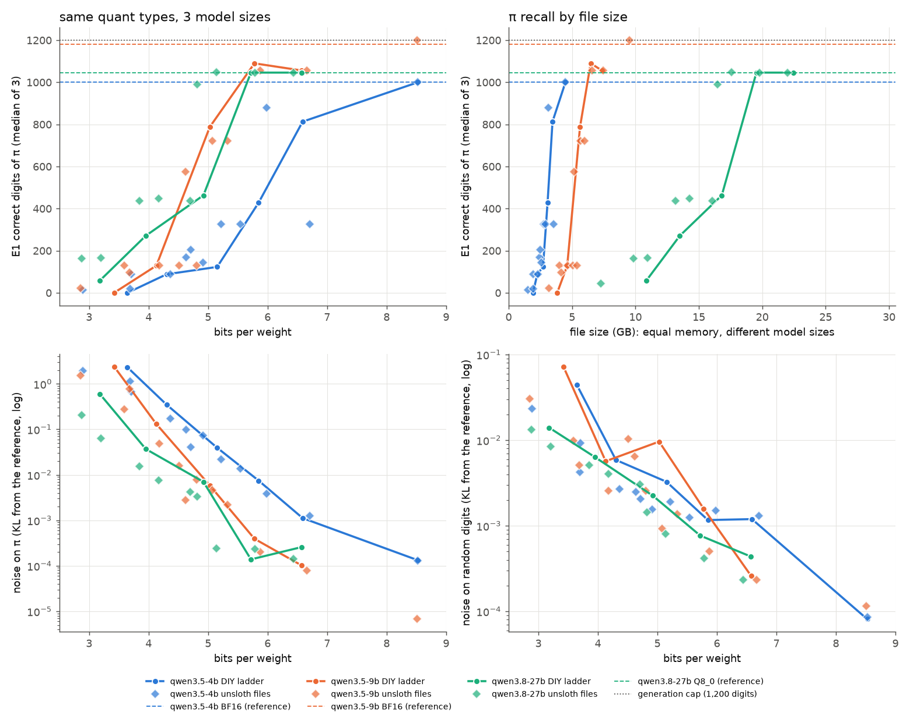

# Phase 3 report: Qwen 3.8 27B, and three model sizes

Kiryl Dubarenka

Phase 1 (4B): [REPORT.md](REPORT.md). Phase 2 (9B): [REPORT_9B.md](REPORT_9B.md). Web version:
[engineeringthefutureai.github.io/bits-of-pi](https://engineeringthefutureai.github.io/bits-of-pi/)

The third model is three times the size of the second. I ran 17 versions of Qwen 3.8 27B, from
Q8_0 down to 2.1 bits per weight, with the same llama.cpp build (`bed0a8566`, SYCL), the same
prompts and the same greedy decoding as Phases 1 and 2. Two things had to change.

- **The reference is unsloth's Q8_0, not BF16.** The BF16 original is 54.7 GB and doesn't fit
  on two 24 GB cards. That is a small compromise. On the 4B and 9B, Q8_0 recited π character for
  character like BF16 in every wording, and the 9B's Q8_0 sat at noise 0.000007 from BF16. All
  noise figures in this report are measured against Q8_0, so they read low by about that much.
- **The three largest files (Q8_0, Q6_K, UD-Q6_K) are split across both Arc Pro B60 cards.**
  The rest run on one card, as before.

The 17 versions:

- My plain ladder (Q6_K, Q5_K_M, Q4_K_M, Q3_K_M, Q2_K), built from unsloth's BF16 exactly as on
  the 4B and 9B, plus Q2_K with my own imatrix (computed on the Q8_0).
- 11 of unsloth's files: Q8_0 (the reference), Q4_0, and nine UD (Unsloth Dynamic) files from
  UD-Q6_K down to UD-IQ2_XXS.

The setup check (E0) passed on Q8_0 and Q6_K. The first word prompt (E4) is skipped, as on the
9B. The full table is [`scores/qwen3.8-27b_headline.md`](scores/qwen3.8-27b_headline.md).

The 27B also belongs to a newer generation (Qwen 3.8) than the 4B and 9B (Qwen 3.5). So size is
not the only thing that changes in the H5 comparison.

## Words used in this report

The Phase 1 report has the full guide: [Words used in this report](REPORT.md#words-used-in-this-report).
The short version:

- **Bits per weight (bpw):** how many bits each of the model's numbers takes in the file. The
  original is 16. Smaller means more compressed.
- **Version names:** Q8_0 down to Q2_K are standard llama.cpp formats, where the number is
  roughly the bits per weight. IQ formats squeeze harder through lookup tables. **us_** means a
  file from unsloth. **UD-** means unsloth's layer-by-layer mix (XL is a larger variant).
  **_imat** means built with my own imatrix (a record of which weights matter most).
- **Tests:** E1 recites π, e and √2 from memory. E2 (teacher forcing) feeds the true digits and
  records how sure the model was of each. E3 copies digits from the prompt. E4b writes digits
  out as words. E5 copies π with one digit deliberately changed. E6 recites π as words.
- **Odds** (how sure the model is of a digit): how many times more likely the right digit is
  than the runner-up. 1× is a tie, 10,000× is certain.
- **Noise:** how far a compressed version's predictions drift from the reference's (the KL
  divergence). 0.0001 means identical answers, about 0.01 means π recall stops in the first few
  hundred digits, and 1 means the model is broken.
- **Markers:** blue circles joined by a line are my plain ladder, green diamonds are unsloth's
  files, the orange square is my imatrix build, and the dashed line or black star is the
  reference.

## Summary

| Hypothesis | 27B verdict | What decided it |
|---|---|---|
| H1: recall survives down to about 4 bits, then falls off a cliff | **No safe zone. The cliff is at 4.9 bpw** | π recall holds at the reference's 1,046 digits down to 5.1 bpw, then falls to 463 at Q4_K_M ([H1](figures/qwen3.8-27b_H1_recall.png)) |
| H2: errors start where the model was least sure | **Confirmed, the clearest of the three models** | The usual stopping point of each 3–5 bit version is the first digit it gets wrong under teacher forcing. The typical stop sits at the 2nd percentile of certainty ([H2](figures/qwen3.8-27b_H2_margins.png)) |
| H3: copying holds up | **Confirmed, the strongest of the three** | Even plain Q2_K copies 17,000 digits without an error. Only UD-IQ2_XXS drops digits ([E3](figures/qwen3.8-27b_H3_E3.png), [E4b](figures/qwen3.8-27b_H3_E4b.png)) |
| H4: the recipe matters | **Confirmed at 4 bits and below** | unsloth's UD-Q4_K_M has half the noise on π of my Q4_K_M, and recites 990 digits against 463 ([H4](figures/qwen3.8-27b_H4_builds.png)) |
| **H5: a bigger model has more room** | **Only at 2–4 bits, and never per byte** | At 5–6 bits the 27B's noise on π matches the 9B's. At Q3_K_M it is 3.5 times lower, at Q2_K 4 times lower. Per GB it is the worst of the three ([H5](figures/H5_model_size.png)) |
| H6: compressed models fall back on memory | **Nothing to fall back on** | Every version, down to UD-IQ2_XXS, copies all 8 planted digits ([H6](figures/qwen3.8-27b_H6_planted.png)) |

What this means if you run the 27B on this hardware:

- **Q5_K_M (19.5 GB) is the smallest file that keeps all the π the model knows.** It fits on one
  24 GB card and writes 18 tokens a second.
- **Q4_K_M already loses half.** At that size, pick unsloth's UD-Q4_K_M, which recites 990 digits
  against 463.
- **Copying survives everything except UD-IQ2_XXS.** That includes plain Q2_K, which broke on
  both smaller models.
- **For exact recall per GB of memory, the 27B is the worst choice of the three.** The 4B at Q8_0
  recites 1,000 digits from 4.5 GB, and the 9B 1,056 from 7.4 GB. The 27B needs 19.5 GB to reach
  1,046.
- **unsloth's UD files with IQ parts are slow on this backend.** They write 8–11 tokens a second,
  against 20–22 for plain K-quants of a similar size.

## H1: the 27B knows fewer digits of π than the 9B

E1 asks for π, e and √2 in three wordings each.

| Constant | 27B Q8_0, by wording | 9B BF16 | 4B BF16 |
|---|---|---|---|
| π | **1046 / 1046** / 463 | 1000 (stops as asked) / 1200+ / 1180 | 1000 / 1000 / 821 |
| e | 50 / **192** / 45 | list format / **192** / 15 | 1,200 zeros / **192** / 211 |
| √2 | 65 / 105 / 98 | 219 / 202 / 203 | 176 / 105 / 102 |

**Q8_0 stops at digit 1,046 of π in two of the three wordings.** After `…2796823030` the real
digits go on `195203530185…`, and the 27B writes `897928530781…`. This is a gap in what the
model memorized. Compression has nothing to do with it:

- Q6_K, UD-Q6_K, Q5_K_M, UD-Q5_K_M and UD-Q4_K_XL stop at exactly the same digit, with noise of
  only 0.0001–0.0003.
- On the 4B and 9B, Q8_0 and BF16 recited π identically.
- The 9B gets past digit 1,046 and reaches the 1,200-digit writing limit.

So the larger, newer model has memorized less π than the 9B. The 27B's ceiling is a real limit at
1,046 digits. The 9B's ceiling was only the writing limit. The third wording stops at 463, one of
the digits Q8_0 is least sure of (see H2).

e repeats what the smaller models did. All three know exactly 192 digits when asked plainly, and
the other wordings produce lists, code or early stops. Only π carries H1.

π recall moves in steps: 1,046, 990, 463, 448, 437, 271, 167 and 163. Each step is one specific
digit, and each is also the first digit that version gets wrong under teacher forcing (H2).

*How to read it:* each marker is one version. Across is bits per weight, so the most compressed
files sit on the left. Up is digits of π recited before the first mistake, the middle of three
wordings. Whiskers run from the worst wording to the best. The long whiskers down to 463 on Q6_K
and Q5_K_M come from the third wording. The dashed line is Q8_0's 1,046.

## H2: certainty predicts every stop

Q8_0 gets all 1,000 teacher-forced digits of π right. How sure it is sits between the 4B and the
9B:

| Model (reference) | Least certain digit | Typical digit | Digits under 20× | Under 150× | Average, first 100 → after 300 |
|---|---|---|---|---|---|
| 4B (BF16) | 1.1× (position 813) | 10,000× | 14 | 73 | 270× → 22,000× |
| 9B (BF16) | 5× (position 10) | 30,000× | 2 | 15 | 700× → 73,000× |
| 27B (Q8_0) | 3× (position 10) | 11,000× | 6 | 20 | 700× → 22,000× |

Each odds figure says how many times more likely the right digit is than the runner-up. The 27B's
six least certain digits are positions 10, 200, 50, 437, 100 and 463, with odds between 3× and
18×. The 4–5 bit versions stop on them, or on digits almost as uncertain:

| Version | First digit wrong under teacher forcing | Q8_0's odds there | Percentile | Where E1 π recall stopped |
|---|---|---|---|---|
| UD-Q4_K_M | 990 | 22× | 1st | 990 / 271 / 990 |
| Q4_K_M | 463 | 18× | 0th | 463 / 463 / 463 |
| Q4_0, UD-Q3_K_XL | 437 | 16× | 0th | 437 |
| Q3_K_M | 271 | 67× | 1st | 271 / 271 / 271 |
| UD-IQ4_XS | 448 | 11,000× | 50th | 448 / 327 / 448 |
| UD-IQ3_XXS | 167 | 1,800× | 21st | 167 / 111 / 167 |
| UD-Q2_K_XL | 163 | 3,600× | 32nd | 163 |
| Q2_K | 75 | 250× | 3rd | 70 / 58 / 43 |

Across all 36 early π stops in free recall, the typical stop sits at the **2nd percentile** of
Q8_0's certainty, and 61% fall in the least certain 10%. I computed the same figures for all three
models with one script: the 12th percentile and 43% on the 4B, the 6th and 61% on the 9B.

The mechanism is the same in all three models. Compression noise grows as bits drop, and the first
digits to fall are the ones the reference holds least firmly. The IQ and 2-bit files are noisy
enough to overturn ordinary digits, with odds of about 1,000 to 8,000. The 4–5 bit files only
overturn the uncertain ones.

One pattern is worth following up. The uncertain digits cluster at round positions: 10, 50, 100
and 200 on the 27B, 10, 100 and 210 on the 4B, 0, 5, 10 and 20 on the 9B. π is often printed in
blocks of 10, 50 or 100 digits, so line breaks in the training text may weaken recall at block
edges.

*How to read it:* the top panel shows how sure Q8_0 is of each of the 1,000 digits, as odds
against the runner-up on a log scale (1× is a tie, and each labelled line is 100 times the one below).
Grey is each digit, and the blue line smooths it over 25 digits. The bottom panel has one row per
version, from least to most compressed, with a dot wherever its top choice is wrong under teacher
forcing. The five rows under the reference have no dots. Q4_K_M's first dot, at 463, lines up with one of
the grey dips above. Several rows share a dot near position 921.

## H3: copying

**Copying digits (E3)**, 17,000 digits per version:

| Version | bpw | Errors | What goes wrong |
|---|---|---|---|
| Q8_0 and 14 others, down to UD-Q2_K_XL | 8.5 → 2.9 | 0–1 | one missing digit inside a run |
| Q2_K, no imatrix | 3.2 | **0** | nothing |
| UD-IQ2_XXS | 2.1 | 104 (2.5 per 100) | chunks dropped |

Plain Q2_K broke on both smaller models (59 and 34 errors per 100 digits, by stopping early). On
the 27B it copies perfectly.

**Writing digits as words (E4b)**, 7,000 digits per version: Q8_0 makes 23 errors, all missing
words inside runs of equal digits (the 9B's BF16 made 78). That stays nearly flat down to 2.9 bpw
(UD-Q2_K_XL: 22). Plain Q2_K adds 17 extra words, and UD-IQ2_XXS doubles the missing words to 71.
No version gets stuck repeating a word.

*Reading the E3 and E4b figures:* one bar per version, the reference on top. Bar length is the
total number of errors. Blue is wrong digits, orange extra ones, and green missing ones.

## H4: builds

| Format | My plain build: noise on π / on random | unsloth's file: noise on π / on random |
|---|---|---|
| Q6_K | 0.00026 / 0.00044 | UD-Q6_K: 0.00014 / 0.00023 |
| Q5_K_M | **0.00014** / 0.00077 | UD-Q5_K_M: 0.00024 / 0.00042 |
| Q4_K_M | 0.0070 / 0.0022 | UD-Q4_K_M: **0.0033** / 0.0014 |
| Q3_K_M | 0.037 / 0.0063 | UD-Q3_K_XL: **0.015** / 0.0051 |
| Q2_K | 0.60 (with my imatrix: 0.45) | UD-Q2_K_XL: **0.21** |

At 5–6 bits the recipe makes no consistent difference, and my Q5_K_M even has the lower noise on
π. From 4 bits down, unsloth's layer-by-layer allocation halves the noise on π or better, and at
Q4 that is the difference between 990 digits and 463. My imatrix helps Q2_K less here than on the
smaller models (0.60 → 0.45, against 2.39 → 0.99 on the 9B). unsloth's legacy Q4_0 has 1.25 times
the π noise of UD-Q4_K_M. UD-IQ4_XS has 1.8 times the π noise of Q4_0 here, although it was the
best file under 5 bpw on the 9B.

*Reading the H4 figure:* one row per format. Each marker is one build of it, and the grey bar spans
the best and worst build. Left: digits of π, further right is better. Right: noise on π on a log
scale, further left is better.

## H5: what model size buys

The plan defines the "cliff" as the most-bits build on the plain ladder whose π recall falls below
half of the reference's.

| Plain ladder | 4B bpw | π | noise on π | 9B bpw | π | noise on π | 27B bpw | π | noise on π |
|---|---|---|---|---|---|---|---|---|---|
| reference | 16.0 | 1000 | 0 | 16.0 | 1180 | 0 | 8.5 † | 1046 | 0 |
| Q8_0 | 8.5 | 1000 | 0.00013 | 8.5 † | 1200 | 0.000007 | | | |
| Q6_K | 6.6 | 813 | 0.0011 | 6.6 | 1056 | 0.00010 | 6.6 | 1046 | 0.00026 |
| Q5_K_M | 5.8 | **428** | 0.0075 | 5.8 | 1090 | 0.00039 | 5.7 | 1046 | 0.00014 |
| Q4_K_M | 5.2 | 123 | 0.039 | 5.0 | 788 | 0.0058 | 4.9 | **463** | 0.0070 |
| Q3_K_M | 4.3 | 88 | 0.35 | 4.1 | **129** | 0.13 | 4.0 | 271 | 0.037 |
| Q2_K | 3.6 | 0 | 2.30 | 3.4 | 0 | 2.39 | 3.2 | 58 | 0.60 |

† unsloth's Q8_0. The 27B's noise is measured against Q8_0 (see the top of this report).

The cliff (in bold) is Q5_K_M on the 4B, Q3_K_M on the 9B and **Q4_K_M on the 27B**. If H5 means
"bigger is sturdier", it holds only in part.

**At 5–6 bits the 27B is no quieter than the 9B.** Both sit at a noise of 0.0001–0.0003 on π. The
9B's large lead over the 4B (10 to 19 times less noise) doesn't grow again at 27B.

**From 4 bits down the 27B pulls ahead.** Its noise on π at Q3_K_M is 0.037, against 0.13 for the
9B and 0.35 for the 4B. At Q2_K it is 0.60 against 2.3–2.4. The 4B and 9B ended up level at Q2_K,
and the 27B stays 4 times below both. Fitted over the same range (Q6_K to Q2_K), its noise on π
grows 12 times per bit removed, against 26 times for the 9B and 13 for the 4B. Its π recall at
Q3_K_M (271) and Q2_K (58) is the best of the three.

**Where the cliff falls depends on where the uncertain digits are, as well as on the noise.** The
27B's Q4_K_M has about the same noise on π as the 9B's (0.0070 against 0.0058). It first goes
wrong at position 463, where Q8_0 was only 18 times surer of the right digit. The 9B's Q4_K_M
survives its own uncertain digit at 267 (37 times) and first goes wrong at 788. The 27B has more
uncertain digits early in π (6 under 20×, against 2 for the 9B), so similar noise costs it more.
Certainty is the main predictor, though not the only one, because noise doesn't land evenly on
every position. How many uncertain digits a model has depends on its training, and the 27B is a
different generation.

**Per byte, the order reverses completely.** The 4B's Q8_0 recites 1,000 digits from 4.5 GB, and
the 9B's Q6_K 1,056 from 7.4 GB. At about 11 GB the 27B's Q2_K recites 58, and the 27B first
reaches its own ceiling at 19.5 GB.

*How to read it:* four panels. Colours are models: blue 4B, orange 9B, green 27B. Circles joined by
a line are the plain ladder, diamonds are unsloth's files. Dashed lines mark each model's
reference, and the dotted line at 1,200 is the writing limit. Top left: π digits against bits per
weight, where the green and orange curves cross. Top right: the same digits against file size in
GB, the view for fitting a card. Each bigger model's curve sits further right without rising
higher. Bottom: noise on π (left) and on random digits (right), on a log scale where each gridline
is 10 times the one below. Lower is better. The green line flattens below 4 bits, which is the
27B's advantage.

The Phase 2 conclusion holds with a third size: **for exact recall, bits per weight matter more
than the number of weights**. A bigger model does help at very low bit widths, where it degrades
more slowly.

## H6: nothing to arbitrate

E5 plants one wrong digit in a copy of π or e. Every 27B version, down to UD-IQ2_XXS, copies all 8
planted digits. As on the 9B, the model trusts the prompt over its memory, so there is no shift
to measure.

## E6: reciting as words works now

On the 4B and 9B, asking for π in English words produced fragments that started in the wrong
place. The 27B does it properly. Q8_0 says "one four one five nine two six five three five…" and
is right for 46 digits of π, 24 of e and 27 of √2. Q5_K_M matches it exactly. Q3_K_M drops to 14,
29 and 0, and Q2_K and below reach 0–3. E6 measures something on the 27B, so it should stay in the
plan.

## Resources and speed

| Version | Cards | File GB | VRAM GiB | Decode tok/s | Prompt tok/s (4k) | Power W |
|---|---|---|---|---|---|---|
| us_Q8_0 | 2 | 29.05 | 27.7 | 13 | 1,093 | 150 |
| Q6_K | 2 | 22.43 | 21.9 | 17 | 1,098 | 184 |
| us_UD-Q6_K | 2 | 21.98 | 21.5 | 16 | 1,091 | 176 |
| Q5_K_M | 1 | 19.54 | 18.5 | 18 | 687 | 165 |
| us_UD-Q4_K_XL | 1 | 17.56 | 16.7 | 16 | 552 | 153 |
| Q4_K_M | 1 | 16.81 | 16.1 | 22 | 594 | 161 |
| us_UD-Q4_K_M | 1 | 16.46 | 15.7 | 15 | 502 | 149 |
| us_Q4_0 | 1 | 16.06 | 15.4 | 21 | 546 | 140 |
| us_UD-IQ4_XS | 1 | 14.25 | 13.8 | 11 | 402 | 140 |
| Q3_K_M | 1 | 13.50 | 13.2 | 20 | 459 | 164 |
| us_UD-IQ3_XXS | 1 | 10.93 | 10.8 | 8 | 327 | 130 |
| Q2_K | 1 | 10.86 | 11.0 | 22 | 539 | 161 |
| us_UD-Q2_K_XL | 1 | 9.83 | 9.8 | 8 | 324 | 132 |
| us_UD-IQ2_XXS | 1 | 7.27 | 7.8 | 10 | 316 | 135 |

- **Versions split over two cards** report graphics memory and power summed over both, and speed
  for the pair. Splitting doesn't make writing faster, because the cards take turns, layer by
  layer: Q6_K on two cards writes 17 tokens a second, like Q5_K_M on one (18). Reading a prompt is
  faster (1,098 against 687 tokens a second at 4k). The speed figure labels these points "2 GPUs".
- **Writing speed** is 13 tokens a second at Q8_0 and 18–22 for the plain K-quants from Q5_K_M
  down. That is about 2.8 times slower than the 9B in the same format.
- **unsloth's UD files are slow on this backend.** UD-Q4_K_XL, UD-Q4_K_M, UD-Q3_K_XL and UD-Q2_K_XL
  write 8–16 tokens a second, against 20–22 for my plain builds of a similar size. Their per-layer
  mixes include IQ parts, which this backend runs slowly.
- **One card is enough for Q5_K_M (18.5 GiB) and below**, with an 8k context.
- **The file contains a layer nobody uses.** Qwen 3.8 ships an extra layer for predicting several
  tokens at once (`blk.64`), which llama.cpp ignores. It is 0.45 GB of the Q8_0 (1.5%) and 0.15 GB
  of Q2_K. File size and bpw include it, which moves every 27B point about 0.1 bpw to the right.
- **Host memory isn't comparable across the table.** Q8_0 and Q6_K ran with the file mapped into
  memory (27.1 and 22.1 GiB). Every later version ran without that (about 0.9 GiB). See below.

*Reading the speed figure:* [`qwen3.8-27b_speed.png`](figures/qwen3.8-27b_speed.png) shows
writing speed (left) and prompt reading speed (right) against bits per weight. Points labelled
"2 GPUs" ran on both cards.

## Problems found and how they were handled

| Problem | Effect | What I did |
|---|---|---|
| The machine ran out of memory twice with the 27B mapped into memory (22–29 GB on a 30 GB machine) | Linux killed the run and the whole login session | The 27B now loads without mapping (`--load-mode none`, set per model as `mmap: false`). Results are unchanged, and host memory drops to about 0.9 GiB. The run also marks itself as first in line to be killed, ahead of the login session |
| One teacher-forced output file was cut short by that crash and looked finished | The broken file would have been reused | A run now counts as done only once `tokens.json`, the last file written, exists |
| llama.cpp's benchmark crashes when it shuts down a model split over two cards | The writing-speed test never ran | Each benchmark test runs on its own, and a result that was printed is kept even if the program then crashes |
| No BF16 reference fits | Noise is measured against Q8_0 | Q8_0 matched BF16 exactly on the 4B and 9B. Stated wherever noise appears |
| An unused layer in the file | File size and bpw read about 1.5% high | Reported. Too small to change any conclusion |

## Next

Questions still open:

- Keep E6? It gave nothing on the 4B and 9B, and measures something on the 27B.
- Should the imatrix sample text include some numbers? My imatrix helped the 27B's Q2_K less than
  the smaller models'.
- Change the seed `20261027`? It looks like a date, and changing it means rerunning everything.
- Do uncertain digits really cluster at block edges (positions 10, 50, 100, 200)? The existing
  teacher-forced data is enough to check.
