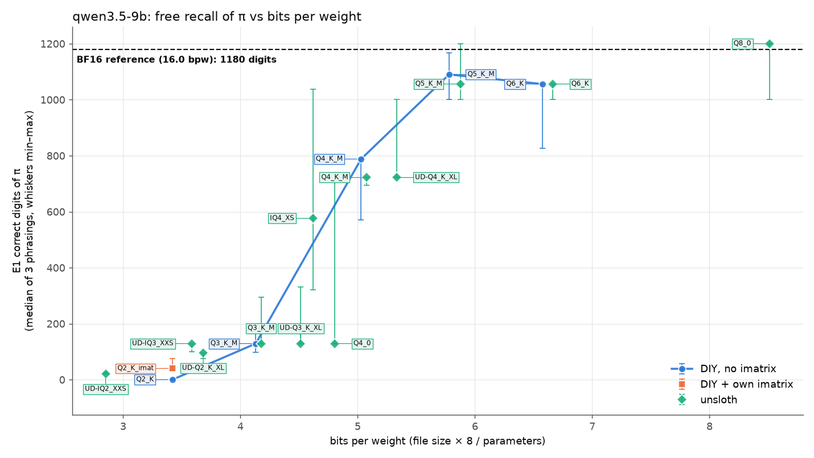
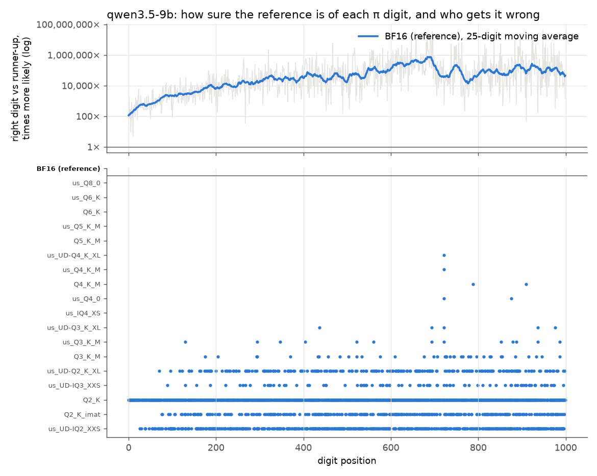

# Phase 2 report: Qwen 3.5 9B, and what model size buys

Kiryl Dubarenka

Phase 1 (4B): [REPORT.md](REPORT.md). Phase 3 (27B): [REPORT_27B.md](REPORT_27B.md). Web
version: [bits-of-pi.engineeringthefuture.ai](https://bits-of-pi.engineeringthefuture.ai/)

Does a bigger model tolerate more compression? To find out I ran 19 versions of Qwen 3.5 9B,
from the uncompressed BF16 original down to 2.9 bits per weight, through the same setup as
Phase 1. Same llama.cpp build (`bed0a8566`, SYCL, one Arc Pro B60 per version), same prompts,
same greedy decoding. The 19 versions:

- unsloth's BF16 (the reference) and 12 of unsloth's published compressed files.
- My plain ladder (Q6_K, Q5_K_M, Q4_K_M, Q3_K_M, Q2_K), built exactly as on the 4B. This is the
  like-for-like comparison between the two sizes.
- Q2_K with my own imatrix.

I didn't repeat the 4B's imatrix experiments, which answered their question already. The first
word prompt (E4) is skipped too, since E4b replaced it. The setup check (E0) passed on BF16 and
unsloth's Q8_0. The full table is [`scores/qwen3.5-9b_headline.md`](scores/qwen3.5-9b_headline.md).

## Words used in this report

The Phase 1 report has the full guide to names, tests and figure markers:
[Words used in this report](REPORT.md#words-used-in-this-report). The short version:

- **Bits per weight (bpw):** how many bits each of the model's numbers takes in the file. The
  original is 16. Smaller means more compressed.
- **Version names:** Q8_0, Q6_K, Q5_K_M, Q4_K_M, Q3_K_M and Q2_K are standard llama.cpp formats,
  where the number is roughly the bits per weight. IQ formats squeeze harder through lookup
  tables. **us_** means a file from unsloth. **UD-** means unsloth's layer-by-layer mix.
  **_imat** means built with my own imatrix (a record of which weights matter most).
- **Tests:** E1 recites π, e and √2 from memory. E2 (teacher forcing) feeds the true digits and
  records how sure the model was of each. E3 copies digits from the prompt. E4b writes digits
  out as words. E5 copies π with one digit deliberately changed. E6 recites π as words.
- **Odds** (how sure the model is of a digit): how many times more likely the right digit is
  than the runner-up. 1× is a tie, 10,000× is certain.
- **Noise:** how far a compressed version's predictions drift from the reference's (the KL
  divergence). 0.0001 means identical answers, about 0.01 means recall of π stops in the first
  few hundred digits, and 1 means the model is broken.
- **Markers:** blue circles joined by a line are my plain ladder, green diamonds are unsloth's
  files, the orange square is my imatrix build, and the dashed line or black star is the
  reference.

## Summary

| Hypothesis | 9B verdict | What decided it |
|---|---|---|
| H1: recall survives down to about 4 bits, then falls off a cliff | **Closer, still no safe zone** | π recall stays above 1,000 digits down to 5.8 bpw and halves between 5.0 and 4.1 bpw ([H1](figures/qwen3.5-9b_H1_recall.png)) |
| H2: errors start where the model was least sure | **Confirmed, weaker form** | No near-tie digits at all. Recall still stops at the 6th percentile of certainty ([H2](figures/qwen3.5-9b_H2_margins.png)) |
| H3: copying holds up | **Confirmed, stronger** | Every build except plain Q2_K and UD-IQ2_XXS copies almost perfectly, and the word-looping the 4B showed at 3.6–4.3 bpw is gone ([E3](figures/qwen3.5-9b_H3_E3.png), [E4b](figures/qwen3.5-9b_H3_E4b.png)) |
| H4: the recipe matters | **Confirmed again** | unsloth's files have less noise on π than my plain ladder at Q4 and Q3, and an imatrix again rescues Q2_K ([H4](figures/qwen3.5-9b_H4_builds.png)) |
| **H5: a bigger model has more room** | **Yes per bit, no per byte** | Recall halves at Q3_K_M (4.1 bpw) instead of Q5_K_M (5.9 bpw). At the same file size, the 4B at 8 bits recalls more ([H5](figures/H5_model_size.png)) |
| H6: compressed models fall back on memory | **Nothing to fall back on** | The 9B already copies every planted digit at BF16, and so does every build that can copy ([H6](figures/qwen3.5-9b_H6_planted.png)) |

What this means if you run the 9B on this card:

- **Q8_0 costs nothing.** Noise on π 0.000007, about 1.9 times faster than BF16, half the
  graphics memory.
- **Q6_K and Q5_K_M recite 1,000+ digits of π.** Q4_K_M recites 700–790. Below 4.5 bpw recall
  drops to about 130.
- **Copying works on almost everything** down to 3.6 bpw, imatrix or not. Plain Q2_K is the
  exception.
- **If memory is your limit and exact recall is the job, a smaller model at 8 bits beats a
  bigger one at 3–4 bits.** At about 4.5 GB, the 4B's Q8_0 recites 1,000 digits and the 9B's
  Q3_K_M recites 129.
- **IQ formats are still slow here.** UD-IQ3_XXS decodes at 20 tokens/s, slower than BF16 (22).

## H5: what the bigger model buys

The plan defines the "cliff" as the most-bits build on the plain ladder whose π recall falls
below half of the reference's.

| Plain ladder | 4B bpw | 4B π digits | 4B noise on π | 9B bpw | 9B π digits | 9B noise on π |
|---|---|---|---|---|---|---|
| BF16 (reference) | 16.0 | 1000 | 0 | 16.0 | 1180 | 0 |
| Q8_0 | 8.5 | 1000 | 0.00013 | 8.5 † | 1200 | 0.000007 |
| Q6_K | 6.6 | 813 | 0.0011 | 6.6 | 1056 | 0.00010 |
| Q5_K_M | 5.9 | **428** | 0.0075 | 5.8 | 1090 | 0.00039 |
| Q4_K_M | 5.2 | 123 | 0.039 | 5.0 | 788 | 0.0058 |
| Q3_K_M | 4.3 | 88 | 0.35 | 4.1 | **129** | 0.13 |
| Q2_K | 3.6 | 0 | 2.30 | 3.4 | 0 | 2.39 |

† unsloth's Q8_0. On the 4B, my Q8_0 and unsloth's were indistinguishable (noise 0.000133
against 0.000131).

The cliff (in bold) is Q5_K_M on the 4B and Q3_K_M on the 9B, about 1.7 bits further down. So
**H5 holds**. How the advantage plays out matters, though.

**The 9B starts with far less noise, and loses its lead as bits drop.** At 8 down to 6 bits its
noise on π is 10 to 19 times below the 4B's. From there it grows faster: 12 times per bit
removed, against 7.6 for the 4B (fitted from Q8_0 to Q2_K on both). By Q2_K the two models are
level, at 2.3–2.4. unsloth's 12 files tell the same story. The 4B has 15–19 times the 9B's noise
on π at Q8_0 to Q5_K_M, 3.6–14 times at 4.2–5.3 bpw, 2.4 times at UD-IQ3_XXS, and only 1.2–1.5
times at UD-Q2_K_XL and UD-IQ2_XXS. Size buys room at moderate compression, and at 2–3 bits that
room is nearly gone.

**At high bits, the 9B's memorized digits are no longer the weak spot.** Its noise on π stays
below its noise on random digits all the way down to Q4_K_M (0.0058 against 0.0096), and only
overtakes it at Q3_K_M. On the 4B, noise on π was already 12 times higher at Q4_K_M. The 9B
holds π more firmly: for a typical digit the right answer is about 30,000 times more likely than
the runner-up, and only one digit is under 7× (the 4B had nine).

**Per byte, the order reverses.** H5 compares models at equal bits per weight. Someone choosing a
file to fit their card compares at equal size, where the bigger model has fewer bits per weight.
At about 4.5 GB, the 4B's Q8_0 recites 1,000 digits, and the 9B's Q3_K_M or UD-Q3_K_XL recite
129. The 9B catches up only from 6.5 GB (Q5_K_M). The 4B at BF16, 8.4 GB, is never needed for
this task. Exact recall needs many bits per weight more than it needs many weights. Copying
points the same way. The 4B copies almost perfectly from 2.3 GB (Q3_K_M), a size that no working
9B build reaches (see H3).

*How to read it:* four panels. Colours are models (blue 4B, orange 9B, green 27B from Phase 3).
Circles joined by a line are the plain ladder, and diamonds are unsloth's files. Dashed lines
are each model's reference, and the dotted line at 1,200 is the generation cap. Top left: π
digits against bits per weight. Top right: the same digits against file size in GB, the view for
fitting a card. The 4B's curve rises first. Bottom: noise on π (left) and on random digits
(right), on a log scale where each gridline is 10 times the one below. Lower is better.

## H1: recall on the 9B

E1 asks for π, e and √2 in three wordings each. BF16 recites π **past the 1,200-digit limit**
on how much the model may write, in one wording, and to 1,180 in another. In the third ("to 1000
decimal places") it stops correctly at 1,000. So the 9B's reference score is a lower bound, and
Q8_0 matches it.

| Constant | 9B BF16, by wording | 4B BF16, by wording |
|---|---|---|
| π | 1000 (stops as asked) / 1200+ / 1180 | 1000 / 1000 / 821 |
| e | list format / **192** / 15 (Python code) | 1,200 zeros / **192** / 211 |
| √2 | 219 / 202 / 203 | 176 / 105 / 102 |

Both models know exactly 192 digits of e when asked plainly. The 9B's headline "e = 15" comes
from the prompt. `e to 1000 decimal places: 2.` is continued as a numbered list
(`2. 1000 decimal places: 3. 10000…`), and `e = 2.` as Python code (`e = 2.718281828459045`).
Only π has the room to carry H1.

π recall moves in steps: 1,056, 722 and 129 come up again and again across unrelated builds.
Each step is one specific digit where the noise first overturns the right answer. Builds of the
same format land on the same steps whether I made them or unsloth did (Q4_K_M: 788 against 722).

*How to read it:* each marker is one version. Across is bits per weight, up is digits of π
recited before the first mistake (the middle of three wordings). Whiskers run from the worst
wording to the best. The dashed line is BF16.

## H2: no near-ties, same mechanism

BF16 gets all 1,000 teacher-forced digits of π right. The 4B had digits where the right answer
was barely ahead, only 1.1 times as likely as the runner-up. The 9B's least certain digit is
position 10, at 5 times, and a typical digit sits at 30,000 times. Certainty also grows deeper
into π: about 700 times over the first 100 digits on average, about 70,000 times after digit 300.
The context the model has already written backs up what comes next.

With no near-ties, the 9B's builds survive noise that broke the 4B. Every version except plain
Q2_K gets position 10 right. Where recall does fail, it still fails on less certain digits, just
not the least certain ones:

- unsloth's Q4_K_M, UD-Q4_K_XL and Q4_0 all first go wrong on the same digit, position 722,
  where BF16 had the right digit at 550 times the runner-up (6th percentile). My plain Q4_K_M
  goes wrong at 788 and 910.
- unsloth's Q3_K_M first goes wrong at 129 (490 times, 5th percentile), the most common stop in
  free recall.
- Over all 38 early π stops in free recall, the typical stop sits at the **6th percentile** of
  BF16's certainty, and 61% fall in the least certain 10%. Counted the same way, the 4B's figures
  are the 12th percentile and 43%.

Certainty still predicts where recall breaks. The 9B needs noise strong enough to overturn odds
of about 400 to 1. The 4B broke at odds of 1.1 to 4.

*How to read it:* top panel, how sure BF16 is of each of the 1,000 digits, as odds against the
runner-up on a log scale (1× is a tie). Grey is each digit, and the blue line smooths it over 25
digits. Bottom panel, one row per version from least to most compressed, with a dot wherever
its top choice is wrong under teacher forcing. The top rows are empty: those builds get every
digit right.

## H3: copying

**Copying digits (E3)**, 17,000 digits per version:

| Version | bpw | Errors per 100 digits | What goes wrong |
|---|---|---|---|
| BF16, Q8_0 | 16, 8.5 | 0.025 | 3 missing digits, all inside runs |
| Q4_K_M → UD-IQ3_XXS → Q2_K_imat | 5.0 → 3.4 | 0.03–0.07 | missing digits inside runs |
| UD-IQ2_XXS | 2.9 | 1.6 | chunks dropped |
| Q2_K, no imatrix | 3.4 | 34 | the model stops early |

Every build from 3.4 to 3.7 bpw except plain Q2_K copies at 0.04–0.07 errors per 100 digits.
Plain Q2_K breaks at both sizes, and an imatrix rescues it at both.

**Writing digits as words (E4b):** the 4B pattern repeats. BF16 drops words inside runs of equal
digits: 78 errors in 7,000 digits, all missing words in runs, or 2.5 per 100 on strings with many
runs. It stays that way down to 3.4 bpw, where Q2_K_imat drops 143 words, 127 of them in runs.
The looping that hit the 4B at 3.6–4.3 bpw (UD-Q2_K_XL 28 and Q3_K_M 10 errors per 100) is gone.
Only UD-IQ2_XXS loops, with 5,216 extra words.

*Reading the E3 and E4b figures:* one bar per version, the reference on top. Bar length is the
total number of errors. Blue is wrong digits, orange extra ones, and green missing ones.

## H4: builds

| Format | My plain build: noise on π / on random | unsloth's file: noise on π / on random |
|---|---|---|
| Q6_K | 0.00010 / 0.00026 | 0.00008 / 0.00023 |
| Q5_K_M | 0.00039 / 0.0016 | 0.00020 / 0.00050 |
| Q4_K_M | 0.0058 / **0.0096** | 0.0046 / **0.00093** |
| Q3_K_M | 0.13 / 0.0057 | 0.049 / 0.0026 |
| Q2_K | 2.39 (with my imatrix: 0.99) | UD-Q2_K_XL: 0.77 |

The recipe matters more on the 9B. At Q4_K_M, generic noise (on random digits) is 10 times
higher in my plain build. At Q3_K_M, noise on π is 2.7 times higher. unsloth's legacy Q4_0 has
1.7 times the π noise of their Q4_K_M, a smaller gap than on the 4B (3.3 times, between my two
builds). Among unsloth's files under 5 bpw, IQ4_XS has the least noise on π (0.0028) and recites
576 digits. It decodes at only 38 tokens/s, though.

*Reading the H4 figure:* one row per format. Each marker is one build of it, and the grey bar
spans the best and worst build. Left: digits of π, further right is better. Right: noise on π on
a log scale, further left is better.

## H6: nothing to arbitrate

E5 plants one wrong digit in a copy of π or e. At high bits the 4B "corrected" π's position 10
back to the real digit from memory. The 9B never does. BF16, and every build except plain Q2_K
and UD-IQ2_XXS, copies all 8 planted digits faithfully. The only unfaithful outputs are failed
copies (plain Q2_K 3 of 8, UD-IQ2_XXS 1 of 8), not digits from memory. The bigger model trusts
the prompt over its memory. H6 assumed the two compete, and at 9B they don't, so there is
nothing for compression to shift.

## Resources and speed

One Arc Pro B60, the same settings as Phase 1. Graphics memory is now the **typical (median)
value during the tests**, not the peak. A few runs showed a brief jump of about 750 MiB while
the model loaded. Phase 1's numbers barely move under the new measure (by 0–7 MiB).

| Version | File GB | VRAM GiB | Decode tok/s | Prompt tok/s (4k) | Power W | Host RAM GiB |
|---|---|---|---|---|---|---|
| BF16 | 17.92 | 15.7 | 22 | 593 | 123 | 18.8 |
| us_Q8_0 | 9.53 | 8.7 | 42 | 1,964 | 132 | 10.1 |
| Q6_K | 7.36 | 6.9 | 50 | 1,987 | 161 | 7.9 |
| Q5_K_M | 6.47 | 6.2 | 53 | 2,067 | 157 | 7.0 |
| Q4_K_M | 5.63 | 5.5 | 60 | 1,821 | 152 | 6.2 |
| us_UD-Q4_K_XL | 5.97 | 5.8 | 52 | 1,833 | 146 | 6.6 |
| us_IQ4_XS | 5.17 | 5.1 | 38 | 1,318 | 135 | 5.8 |
| Q3_K_M | 4.62 | 4.7 | 57 | 1,461 | 154 | 5.3 |
| us_UD-IQ3_XXS | 4.02 | 4.1 | 20 | 982 | 117 | 4.6 |
| Q2_K | 3.83 | 4.1 | 61 | 1,669 | 150 | 4.6 |
| us_UD-IQ2_XXS | 3.19 | 3.4 | 31 | 996 | 137 | 3.8 |

- **Graphics memory is below the file size plus 770 MiB.** The 9B keeps its input vocabulary
  table separate from its output layer (the 4B shares one), and llama.cpp leaves that table in
  ordinary memory. Compared with the file, graphics memory ranges from 1.0 GiB less at BF16 to
  0.5 GiB more at Q2_K, which matches the size of that table in each format. Q4_K_M fits an 8 GB
  card with an 8k context. BF16 needs 16 GB.
- **Smaller files stop getting faster below about 5 bpw again.** Decode goes 22 → 42 → 60
  tokens/s from BF16 to Q8_0 to Q4_K_M, then stays at 57–61 down to Q2_K. The 9B is 1.5–1.7
  times slower than the 4B in the same format.
- **IQ formats:** UD-IQ3_XXS (20 tokens/s) and UD-IQ2_XXS (31) are the slowest compressed
  builds, and IQ3_XXS is slower than BF16 itself.
- **Host memory** still follows the file size, because the file is mapped into memory. BF16 peaks
  at 18.8 GiB of this machine's 30 GB.

*Reading the speed and memory figures:* in
[`qwen3.5-9b_speed.png`](figures/qwen3.5-9b_speed.png), left is decode speed and right is prompt
speed, both against bits per weight, and the black star is BF16. In
[`qwen3.5-9b_vram_quality.png`](figures/qwen3.5-9b_vram_quality.png), across is the graphics
memory each version needs, left is π digits, right is noise on π.

## Problems found and how they were handled

| Problem | Effect | What I did |
|---|---|---|
| Peak graphics memory caught spikes (~750 MiB) while models loaded | Q3_K_M looked 1.1 GiB larger than its file | Summaries now record the typical value too, and the analysis uses it for both models |
| BF16 recites π past the 1,200-token writing limit | The 9B's reference is a lower bound | Reported. It doesn't affect the cliff, which is half the reference |
| The e prompts were read as a list or as code | The median e score of 15 comes from the prompt | Reported per wording. π carries H1 |
| E6 (recall as words) | Still nothing usable: π comes out in fragments ("one five nine two six five…") from the wrong start | Reported as something the 9B can't do either |

## Next

Phase 3, the 27B (Qwen 3.8 27B), is in [REPORT_27B.md](REPORT_27B.md). Questions still open:

- Should the imatrix sample text include some numbers?
- Change the seed `20261027`? It looks like a date, and changing it means rerunning everything.
