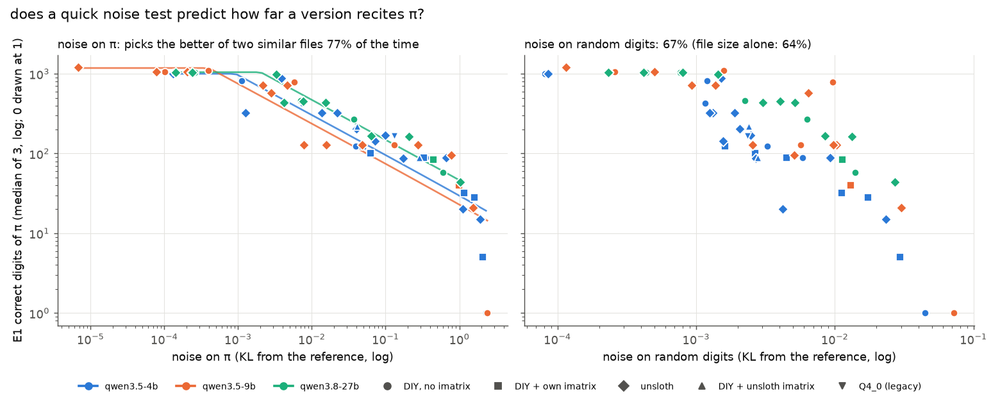
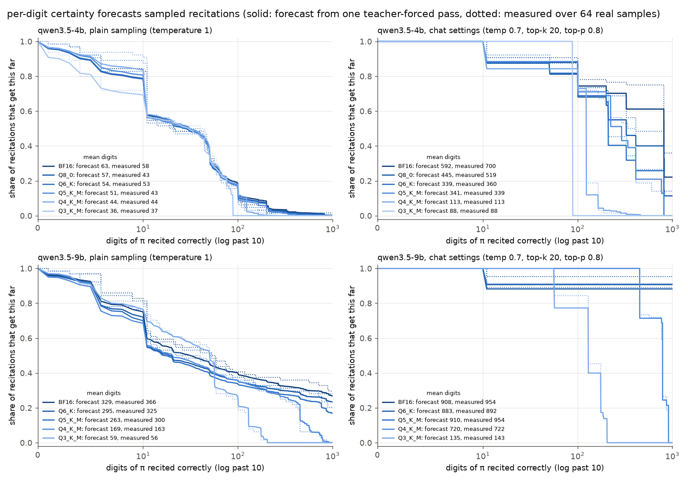
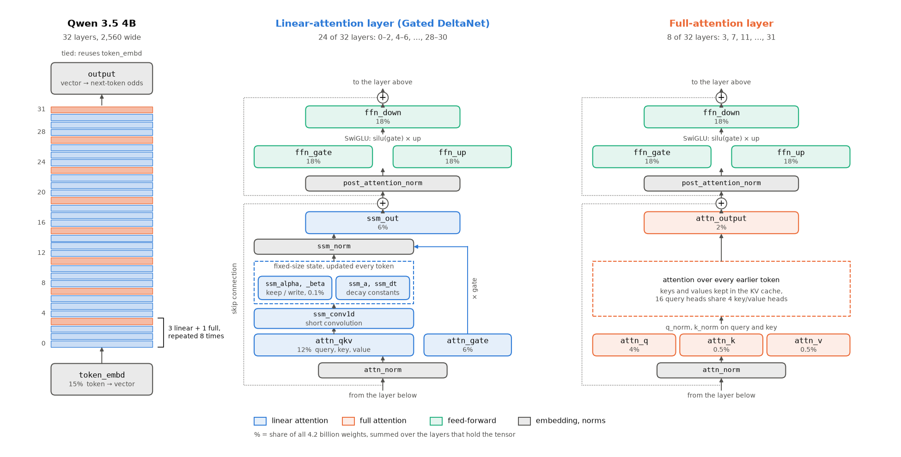
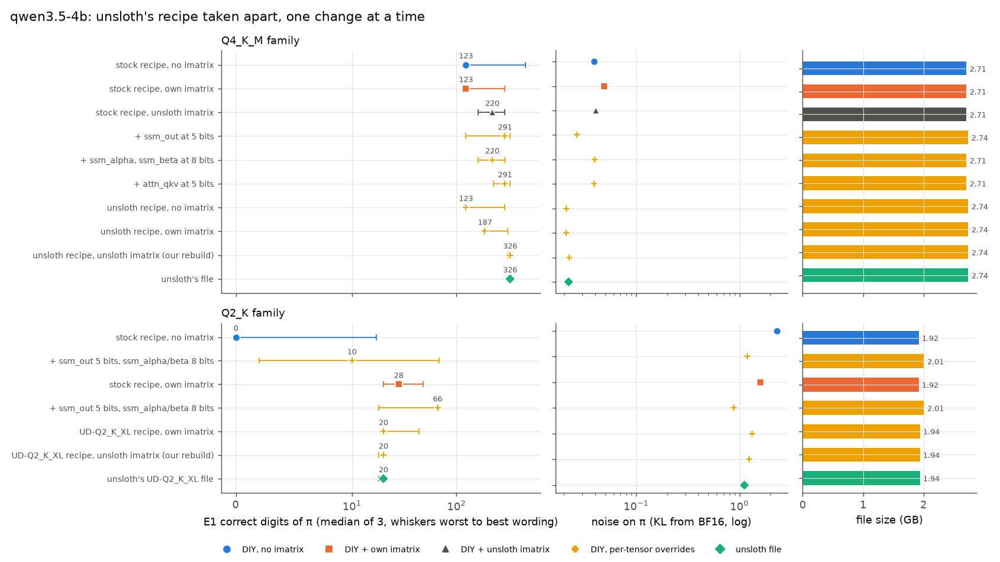

# Follow-ups: the noise score, sampling, and unsloth's recipe

Phase 1 (4B): [REPORT.md](REPORT.md). Phase 2 (9B): [REPORT_9B.md](REPORT_9B.md). Phase 3 (27B):
[REPORT_27B.md](REPORT_27B.md). Web version:
[bits-of-pi.engineeringthefuture.ai](https://bits-of-pi.engineeringthefuture.ai/)

Three questions were left over after Phase 3. I answered them on the same llama.cpp build
(`bed0a8566`, SYCL), with the same prompts and the same scoring.

1. **Can the noise score stand in for the slow recall test?** Answering it took no new runs, only
   the 61 compressed versions already measured in Phases 1–3.
2. **Does per-digit certainty predict what sampling does?** Every earlier test was greedy and always
   took the top choice. Chat apps sample. I drew 128 recitations of π from each of 11 versions of
   the 4B and 9B and set them against a forecast built from teacher forcing alone.
3. **Why do unsloth's files beat standard builds of the same size?** I rebuilt unsloth's Q4_K_M and
   UD-Q2_K_XL for the 4B one change at a time, which made 10 new versions, each run through every
   test.

[The Phase 1 guide](REPORT.md#words-used-in-this-report) explains the terms. **Odds** is how many times more likely the right digit is than the runner-up.
**Noise** is the KL divergence between a compressed version's predictions and the reference's.
Lower is better.

## Summary

| Question | Answer |
|---|---|
| Can noise stand in for recall? | **Yes, when it is measured on π.** Within each model, more noise on π means fewer digits recited (rank correlation −0.96 for the 4B, 9B and 27B alike). Noise on random digits ranks the versions worse, and file size worse again |
| Does certainty predict sampling? | **Closely.** For most versions the forecast lands within a few percent of the mean measured over 64 real runs. At chat settings it reads 5–20% low for the least compressed versions, because a few near-tie digits get slightly different probabilities when the model writes one token at a time |
| What does sampling do to recall? | **At temperature 1 the sampler sets the 4B's limit.** Every 4B version, BF16 included, averages 40–60 digits. At chat settings (temperature 0.7, top-p 0.8) recall stays near greedy |
| Why does unsloth's Q4_K_M win? | **It needs two things together.** One is their imatrix. The other is extra bits on two parts of Qwen 3.5's linear-attention layers (`ssm_out`, `attn_qkv`). Built from their recipe and their imatrix, my file recites π exactly like theirs |
| And at 2 bits? | **A simpler build wins.** Standard Q2_K with my imatrix and the same linear-attention parts raised recites 66 digits against unsloth's 20. It copies far better and writes 35% faster, from a file 4% larger |

## 1. A quick noise test predicts recall

Recall (E1) costs 9 long requests per version and answers in big steps, so a version stops at digit
123 or at 291 and never in between. Noise comes from one teacher-forced pass (E2). It's a smooth
number, and if it tracks recall it could rank new files in a few seconds each.

*How to read it:* each marker is one compressed version, coloured by model (blue 4B, orange 9B,
green 27B) and shaped by how it was built. Up is digits of π recited, the middle of three wordings.
Across is noise. Both axes are log scales, so further left means a closer copy of the reference.
The left panel measures noise on π's own digits and the right panel on random digits that nobody
can have memorized, and the lines on the left are the fitted relationship, one per model, capped
at what that model's reference recites.

**Measured on π, the points fall into line.** I fitted one slope for all three models with a
separate offset for each. Every tenfold drop in noise buys about 3.2 times as many digits. A
typical version sits within a factor of 2.1 of its line, and on log scales the fit explains 76% of
the spread. At equal noise the 27B's line sits a little higher and the 9B's a little lower.

**Measured on random digits, they scatter.** Same versions, much looser order. Noise on random
digits picks up generic damage and can't see whether the weights holding π came through.

In practice you choose between two files of about the same size. I took every pair of versions of
one model within 0.5 bits per weight of each other, 99 pairs that differ in recall, and checked
which score picks the one that recites more.

| Picking the better file by | Right |
|---|---|
| Lower noise on π | 76 of 99 (77%) |
| Lower noise on random digits | 66 of 99 (67%) |
| Larger file | 63 of 99 (64%) |

Generic noise adds only 3 points over file size. Measuring on π adds 13, so the text you measure
on should be the kind you care about.

The fit misses where one digit decides everything. A version can have little noise overall and
still flip a single digit the reference was only fairly sure of. The 9B's unsloth Q4_0 and
UD-Q3_K_XL both lose such a digit at 129. Noise sets
how often flips happen, and which digit goes first is partly luck (section 3 has a clean case).

## 2. Certainty forecasts what sampling does

A sampler trims the model's probabilities according to its settings and then draws each token at
random. I used two settings.

- **Temperature 1:** the model's own probabilities with nothing trimmed.
- **Chat settings:** temperature 0.7, top-k 20, top-p 0.8, which are Qwen's recommended values.
  Top-p 0.8 keeps the likeliest digits until they cover 80% of the probability and throws away
  the rest.

Each version got two numbers per setting, one predicted and one measured.

**The measurement.** I started llama.cpp's server with the version loaded and the sampler set,
sent the π prompt the teacher-forced test reads ("Pi to 1000 decimal places: 3."),
and let the model write. That was repeated 64 times with seeds 1 to 64, so each run drew different
random numbers. I read each recitation as it streamed and stopped it at the first wrong digit, or
at 1,000. The score of a run is how many digits it got right. In the tables below, "measured" is
the mean over the 64 runs.

**The forecast.** It comes from one teacher-forced pass on the same version and no sampling at
all. Teacher forcing feeds the model the prompt plus the 1,000 true digits in one go and reads off,
at every digit, the probability the model gives to each possible next token. Qwen writes each
digit as its own token, so that is the model's view of the next digit. I kept the 32 most likely
tokens at each position, which hold at least 96% of the probability everywhere. Then, for each position:

1. I applied the sampler's trimming to those probabilities, in llama.cpp's order. Top-k 20 keeps
   the 20 likeliest tokens. Top-p 0.8 rescales the survivors to add up to 1 and keeps the
   likeliest ones until they reach 80%. Temperature 0.7 sharpens what is left (each probability
   raised to the power 1/0.7, then rescaled to add up to 1). At temperature 1 nothing is trimmed.
2. I read off the share left for the right digit, which is the chance a single draw picks it, or 0
   if top-k or top-p threw the right digit out.

A run that is still correct at digit 300 has seen exactly the text teacher forcing fed in up to
that point. So the model's probabilities for digit 301 are the ones teacher forcing recorded, and
the chance of getting the first n digits right is the product of the first n per-digit chances.
That product, for every n from 1 to 1,000, is the forecast curve in the figure. Adding up the curve
gives the expected number of correct digits, which is the "forecast" in the tables.

As an example, take the 4B's BF16 at temperature 1. At position 10 it gives the right digit 0.73
and the runner-up 0.18, so the forecast curve drops by about a quarter there. A digit the model
gives 0.99 barely moves it.

*How to read it:* four panels, the 4B on top and the 9B below, temperature 1 on the left and chat
settings on the right. Each colour is one version, darker for less compression. Up is the share of
runs still correct at a digit, and across is the digit position, linear up to 10 and log scale
beyond. Solid lines are the forecast. Dotted lines are the share measured over the 64 real runs,
and where the two overlap the forecast was right.

Mean digits recited correctly, forecast / measured. Greedy is the first digit the version gets
wrong under teacher forcing, which is where greedy decoding of this prompt stops (1000 means none):

| 4B version | Greedy | Temperature 1 | Chat settings |
|---|---|---|---|
| BF16 | 1000 | 63 / 58 | 592 / 700 |
| Q8_0 | 813 | 57 / 43 | 445 / 519 |
| Q6_K | 813 | 54 / 53 | 339 / 360 |
| Q5_K_M | 813 | 51 / 43 | 341 / 339 |
| Q4_K_M | 123 | 44 / 44 | 113 / 113 |
| Q3_K_M | 88 | 36 / 37 | 88 / 88 |

| 9B version | Greedy | Temperature 1 | Chat settings |
|---|---|---|---|
| BF16 | 1000 | 329 / 366 | 908 / 954 |
| Q6_K | 1000 | 295 / 325 | 884 / 892 |
| Q5_K_M | 1000 | 263 / 300 | 910 / 954 |
| Q4_K_M | 788 | 169 / 163 | 720 / 722 |
| Q3_K_M | 175 | 59 / 56 | 135 / 143 |

**The 4B at temperature 1 can't recite π at any size.** Around 45% of samples from every version,
BF16 included, have gone wrong by digit 10. At position 10 even BF16 gives the right digit only
0.73, so about one draw in four takes a wrong one. Digits 100 and 200 thin out the survivors
again. Of 64 BF16 samples, one reached digit 1,000. Going from BF16 to Q4_K_M
moves the mean from 58 to 44, a small cost next to the sampler's.

**The 9B mostly can.** A third of its samples are also gone by digit 10. The rest run long, and 19
of 64 BF16 samples finish all 1,000 digits. Compression shows up here. Q6_K and Q5_K_M stay near BF16,
Q4_K_M halves the mean with only one sample getting past digit 788, and Q3_K_M ends near 60.

**Chat settings shield the digits the model is sure of.** Once the right digit has at least 80%,
top-p 0.8 drops every runner-up, so that digit can't go wrong. Most digits clear the bar easily and
only near-ties carry risk. The 9B down to Q5_K_M completes all 1,000 digits in 57–61 of 64
samples. Sometimes a sample even beats greedy. The 4B's Q8_0 always stops at 813 when greedy,
and 9 of its 64 chat samples got past it.

**Where the forecast misses.** At chat settings it reads low for the least compressed versions:
the 4B's BF16 by 15% (592 forecast, 700 measured), its Q8_0 by 14%, the 9B's BF16 and Q5_K_M by
about 5%. I checked one case by hand against the BF16 server. Fed the true digits in one pass, the
model gives digit 326 a probability of 0.780, while writing token by token it gives 0.816. Those
land on opposite sides of the 0.8 cut. The forecast therefore keeps the runner-up in play at 326,
and the real sampler drops it. Digits 813 (0.523 in one pass, 0.550 while writing) and 821 (0.622
and 0.641) shift the same way, towards the right digit. The prompt tokens match both ways. That
points at how the arithmetic is batched during writing. A 2–3% shift matters only at a
near-tie, and only where top-p turns it into all or nothing. Everywhere else the forecast sits
within the spread 64 samples allow. I left it untuned.

For anyone serving these files:

- **Greedy results carry over to chat settings,** give or take the near-tie digits.
- **At temperature 1 the sampler sets the limit for the 4B, whatever the file.** The 9B gets far
  enough for compression to show again, and keeps about 300 digits on average down to Q5_K_M.
- **To forecast the mean for any sampler setting, one teacher-forced pass with the top candidates
  saved is enough.** Nothing has to be generated.

## 3. Taking unsloth's recipe apart

In Phase 1, unsloth's Q4_K_M of the 4B recited 326 digits of π. A standard Q4_K_M of nearly the
same size (2.71 GB against 2.74) recited 123. Swapping in unsloth's imatrix got the standard build
to 220, so their imatrix explained part of the gap and something else explained the rest.

**What unsloth's file does differently.** I read the storage type of every part of the model from
both files. Qwen 3.5-4B has 32 layers, of which 24 use linear attention (Gated DeltaNet, whose
weights llama.cpp names `ssm_*` and `attn_qkv`) and 8 use full attention. Compared with a standard
Q4_K_M, unsloth's file

- keeps `ssm_out`, the output of each linear-attention layer, at 5 bits instead of 4 (30 MiB more),
- keeps `ssm_alpha` and `ssm_beta`, two small gates, at 8 bits,
- keeps `attn_qkv` at 5 bits in every linear-attention layer, where llama.cpp's recipe uses 6 bits
  in some layers and 4 in others,
- and mixes the types of `attn_v` differently across layers.

Stock llama.cpp treats these linear-attention parts by the rules it has for ordinary attention.
unsloth tuned them by hand.

*How to read it:* read bottom up. The left column is the whole model, with linear-attention layers
in blue and full-attention layers in orange (three blue, then one orange, eight times over). The
panels open up one layer of each kind, with every tensor and its share of the model's weights. The
tensors unsloth raises, `attn_qkv`, `ssm_out` and the two gates `ssm_alpha` and `ssm_beta`, all sit
in the blue panel. [QUANTIZATION_GUIDE.md](QUANTIZATION_GUIDE.md#inside-the-models) describes each
part.

To pull the recipe apart I gave the pipeline two new options, one that sets any part's type by
name and one that copies every part's type from an existing file, and built 10 versions with them.
All 10 ran the full set of tests.

| 4B version | File GB | π digits (range) | First digit wrong, teacher-forced | Noise on π | Noise on random |
|---|---|---|---|---|---|
| Standard Q4_K_M | 2.71 | 123 (123–459) | 123 | 0.039 | 0.0033 |
| + my imatrix | 2.71 | 123 (123–291) | 123 | 0.049 | 0.0016 |
| + unsloth's imatrix | 2.71 | 220 (161–291) | 291 | 0.041 | 0.0024 |
| … + `ssm_out` at 5 bits | 2.74 | 291 (123–326) | 123 | 0.027 | 0.0021 |
| … + `ssm_alpha`, `ssm_beta` at 8 bits | 2.71 | 220 (161–291) | 291 | 0.040 | 0.0025 |
| … + `attn_qkv` at 5 bits | 2.71 | 291 (227–326) | 291 | 0.039 | 0.0021 |
| unsloth's recipe, no imatrix | 2.74 | 123 (123–291) | 123 | 0.021 | 0.0025 |
| unsloth's recipe + my imatrix | 2.74 | 187 (187–307) | 187 | 0.021 | 0.0015 |
| **unsloth's recipe + unsloth's imatrix** | 2.74 | **326 (307–326)** | 326 | 0.022 | 0.0018 |
| unsloth's file | 2.74 | 326 (307–326) | 326 | 0.022 | 0.0019 |

*How to read it:* two blocks, Q4_K_M on top and Q2_K below, one row per build. Yellow crosses are
builds with parts set by hand. The other markers follow the earlier reports: blue circle for a
standard build, orange square for my imatrix, dark triangle for unsloth's imatrix, green diamond
for unsloth's file. Left: digits of π, the middle of three wordings, with whiskers from the worst
wording to the best (further right is better). Middle: noise on π on a log scale (further left is
better). Right: file size.

**The rebuild matches unsloth's file exactly.** Built from their recipe and their imatrix, it
recites π the same way in all three wordings and misses the same digits under teacher forcing
(326, 464, 607, 649, 767 and 813). Its noise agrees to two figures, so the recipe and the imatrix account for the whole file.

**The recipe halves the noise on π whether or not there is an imatrix,** from 0.039 down to 0.021.
`ssm_out` alone does most of that (0.027). The 8-bit gates change nothing I could measure.

**Recall also needs the right imatrix.** With no imatrix, unsloth's recipe still recites 123
digits, because it still flips digit 123, where BF16 was 458 times sure. My imatrix moves the first
flip to 187 (77 times sure). Only unsloth's imatrix clears every early flip, which pushes the first
error out to 326. BF16 itself was only 3.8 times sure there, so no 4-bit file of this model is
likely to get much further.

Halving the noise made every flip half as likely. Which digit flips first was decided by the text
behind the imatrix. Mine contains no numbers (see Phase 1). unsloth's evidently has enough of them
to cover π's early digits.

**At 2 bits the order of the builds changes.**

| 4B version | File GB | π digits (range) | Noise on π | Copy errors per 100 (E3) | Word copy errors per 100 (E4b) | Writing tok/s |
|---|---|---|---|---|---|---|
| Standard Q2_K | 1.92 | 0 (0–17) | 2.30 | 59 | 100 | 91 |
| + `ssm_out` 5 bits, gates 8 bits | 2.01 | 10 (2–68) | 1.20 | 0.94 | 79 | 89 |
| + my imatrix | 1.92 | 28 (20–48) | 1.60 | 0.06 | 70 | 91 |
| **+ my imatrix, `ssm_out` 5 bits, gates 8 bits** | 2.01 | **66 (18–66)** | **0.88** | 0.10 | **1.1** | 89 |
| unsloth's UD-Q2_K_XL recipe + my imatrix | 1.94 | 20 (20–44) | 1.32 | 0.18 | 34 | 66 |
| unsloth's UD-Q2_K_XL recipe + unsloth's imatrix | 1.94 | 20 (18–20) | 1.25 | 0.05 | 34 | 66 |
| unsloth's UD-Q2_K_XL file | 1.94 | 20 (18–20) | 1.12 | 0.20 | 28 | 66 |

Copy errors per 100 count wrong, missing or extra digits for every 100 copied. Lower is better.

Raising `ssm_out` and the two gates halves the noise on π at Q2_K too, with or without an imatrix.
Add my imatrix and it becomes the best 2-bit file in the study. It recites 66 digits of π, has less
noise on π than unsloth's UD-Q2_K_XL, and copies digits spelled as words with 1.1 errors per 100
where unsloth's file makes 28. unsloth's file wins on random digits (noise 0.004 against 0.012).
It also uses IQ formats in places, and those are slow on SYCL: 66 tokens a second against 89. My
rebuild of UD-Q2_K_XL matches their file digit for digit, though its noise on π is 10% higher,
possibly from a slightly different llama.cpp build on their side.

If you build your own files for Qwen 3.5:

- **Raise `ssm_out` one step** (`--tensor-type ssm_out=q5_K`, at Q4_K_M and at Q2_K), which costs
  about 1% of the file and halves the noise on π.
- **Pick the imatrix sample text with care.** It decides which digits survive, and text with no
  numbers in it protects none.
- **At 2 bits, also set `ssm_alpha=q8_0` and `ssm_beta=q8_0`,** and avoid IQ formats on SYCL.

## Problems found and how they were handled

| Problem | Effect | What I did |
|---|---|---|
| The 9B BF16 was mapped into memory (16.6 GB) while a 4B build ran on the other card | Linux ran out of memory and killed the session running both | The 9B now loads without mapping, as the 27B already did. Each job runs as its own service, first in line to be killed |
| Writing one token at a time shifts near-tie probabilities by 2–3% | The chat-settings forecast reads low for BF16 and Q8_0 | Checked against the server and reported. The forecast is left untuned |
| Sampling's teacher-forced files would have made the pipeline think E2 was done | Teacher forcing could have been skipped on later runs | Those files go to their own `sampling/` folder |

## Next

Questions still open:

- Would an imatrix built from ordinary text plus some numbers protect π as well as unsloth's?
  Section 3 points there for the remaining gain.
- Do the same `ssm_out` and `attn_qkv` changes help the 9B and 27B? Both share the linear-attention
  design.
